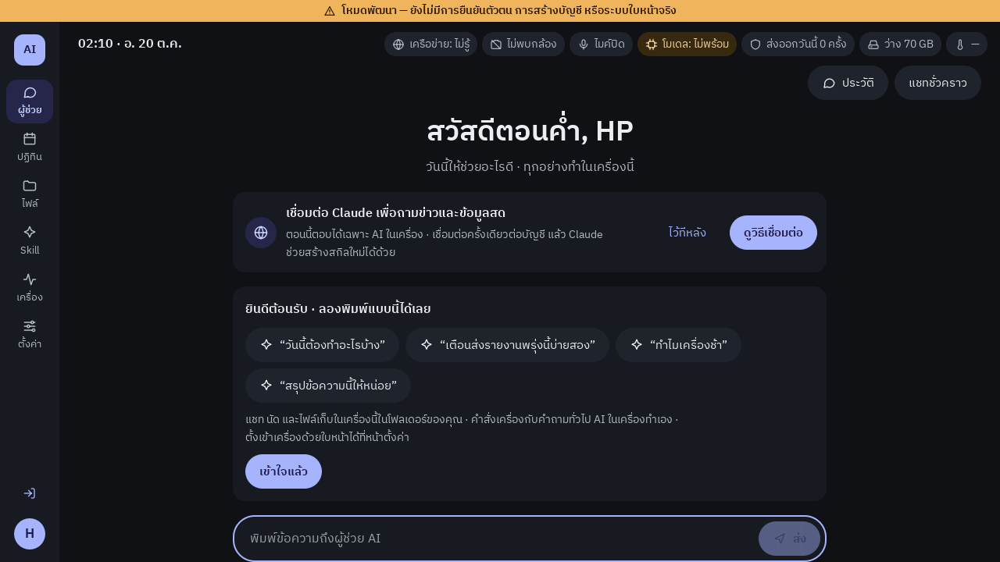
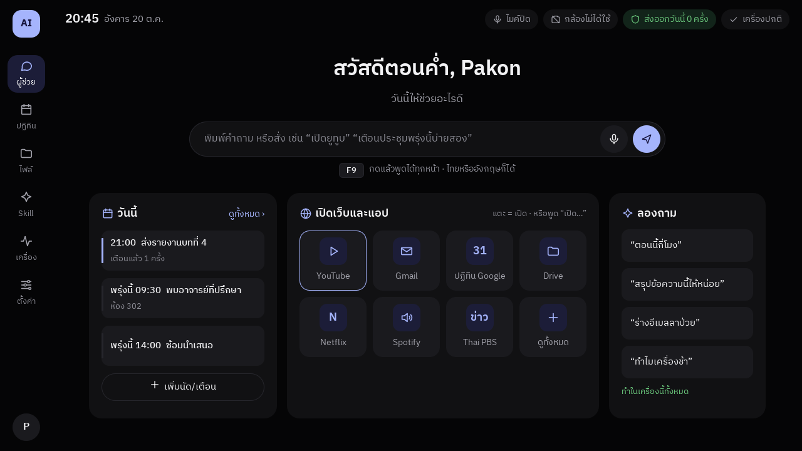
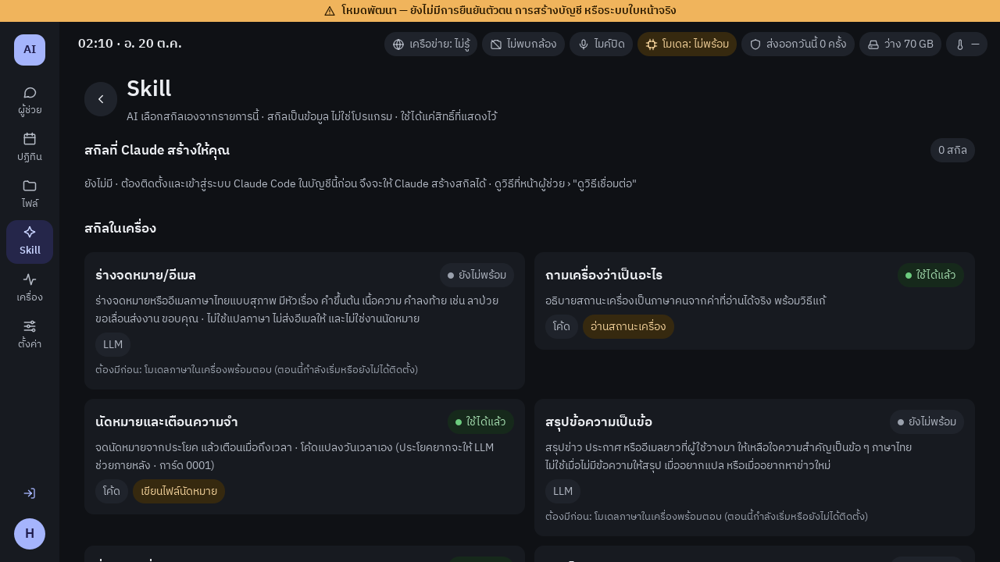
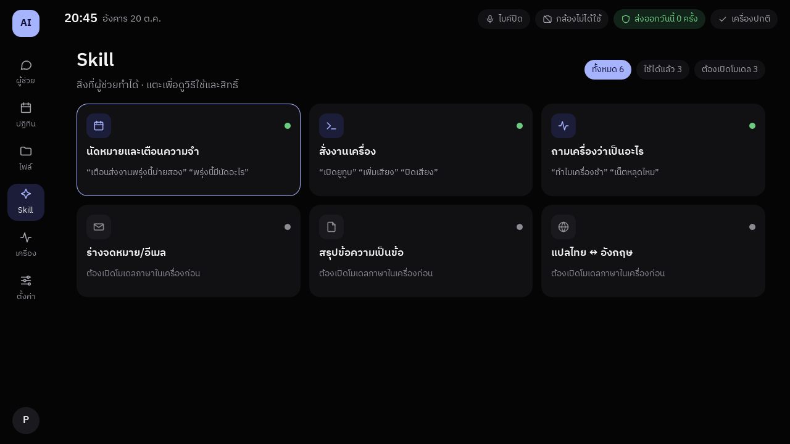

# การ์ดออกแบบ 0041: ธีมดำ + หน้าแรกที่ "เห็นว่ามีอะไรให้ทำ"

- **สถานะ:** **อนุมัติแล้ว (2026-10-20 · Pakon: อนุมัติ · ธีมผู้ใช้เดิม = ทาง ก · เก็บไฟล์สกิลไว้ใน git)** · กำลังสร้างระยะ 1 บนสาขา `feature/0041-black-theme`
- **ข้อกำหนดที่อ้าง:** BRIEF 5.7 (ข้อ 2–6 · ควรมี: ธีมสว่าง/มืด · เกณฑ์ ≥ 50 fps · SUS ≥ 70) · การ์ด 0002 (สีคราม ไม่ชนสีความหมาย) · 0036/0039 (เปิดเว็บ) · 0037/0038 (นัดวันนี้) · H3 H5 H6 H7 H9
- **เครื่องมือออกแบบ:** สกิล `ui-ux-pro-max` (Pakon ให้ติดตั้ง 2026-10-20) · แนะนำสไตล์ **Dark Mode (OLED)** + ข้อห้ามที่ใช้: contrast ≥ 4.5:1 · ปุ่ม ≥ 44 px · ไอคอน SVG ไม่ใช้ emoji · ภาพเคลื่อนไหว 150–300 ms เฉพาะ opacity/ตำแหน่ง · ไม่มีภาพเคลื่อนไหววนไม่หยุด ·
  **ข้อแนะนำที่ไม่ใช้ และเหตุผล:** ฟอนต์ Caveat/Quicksand (ไม่มีอักษรไทย · BRIEF 5.7 ข้อ 4 ใช้ IBM Plex Sans Thai) · สีส้มเป็นปุ่มหลัก (ส้มในระบบเรา = "ข้อมูลออกนอกเครื่อง/เตือน") · glow/เงาเรืองแสง (Pi วาดด้วย GPU เล็ก)

## ภาพ (เรนเดอร์ด้วย Qt ฟอนต์และไอคอนชุดเดียวกับแอป · ค่าในภาพเป็นตัวอย่าง)

| ตอนนี้ | ที่เสนอ |
|---|---|
|  |  |
|  |  |

ไฟล์ต้นแบบ: `img/0041-mock.qml` (ไม่ใช่โค้ดแอป · ไว้เปิดดู/ปรับก่อนสร้างจริง)

## 1. ปัญหาที่แก้ และใครใช้

ผู้ใช้ทุกคนที่เข้าสู่ระบบ: หน้าแรกตอนนี้เป็นตัวหนังสือเยอะ (การ์ดแนะนำ + การ์ดเชื่อม Claude) แถบบนมีป้าย 7 อัน และไม่มีปุ่มให้ "ลองกด" → คนใหม่ไม่รู้ว่าระบบทำอะไรได้ ·
เปิด YouTube ต้องพิมพ์หรือพูด (ไม่มีทางแตะครั้งเดียว)

## 2. หลักการที่ใช้ตัดสิน

| หลักการ | ใช้ยังไง |
|---|---|
| H3 ความเป็นส่วนตัวเป็นค่าเริ่มต้น | ป้ายไมค์/กล้อง **แสดงข้อความเต็มเสมอ** (เหมือนเดิม) · ป้าย "ส่งออกวันนี้ N ครั้ง" อยู่ที่เดิม |
| H5 ความจริงก่อนความสวย | ไทล์เว็บมาจากตารางเว็บในโค้ด (`skills/actions.py`) เท่านั้น · สกิลที่ยังใช้ไม่ได้บอกเหตุผลจริง (เช่น ต้องเปิดโมเดล) · "วันนี้" ว่าง = บอกว่าว่าง ไม่ใส่ตัวอย่าง |
| H6 งานที่ต้องถูกแน่นอน = โค้ด | แตะไทล์ = ส่งคำสั่งเดียวกับที่พิมพ์ ("เปิดยูทูบ") ผ่านตัวจับคำสั่งเดิม · ไม่มีทางลัดใหม่ที่ข้ามการยืนยัน |
| H7 backend ตัดสินสิทธิ์ | หน้าจอแค่ส่งข้อความ · สิทธิ์ยังตัดสินที่ `SkillsController` |
| H4 พอดี Pi 5 | ไม่มีเงา/เบลอ/ภาพเคลื่อนไหววน · ใช้ token สีเดิม (เปลี่ยนค่า ไม่เพิ่มระบบใหม่) |

## 3. ความสัมพันธ์กับชิ้นส่วนอื่น

- **พึ่ง:** `Theme.qml` (token สีที่ทุกหน้าใช้อยู่แล้ว) · ตารางเว็บใน `skills/actions.py` · agenda (0037) · `SkillsController.handle` · ทั้งหมดมีแล้ว
- **กระทบ:** ทุกหน้าได้สีใหม่อัตโนมัติผ่าน token · หน้าที่เปลี่ยนโครง: หน้าแรกผู้ช่วย (`WorkspacePage.qml` ส่วนต้อนรับ) · `StatusBar.qml` · `SkillsPage.qml`
- **ชั้น:** หน้าจอ (QML) อย่างเดียว · backend เพิ่มแค่ property อ่านอย่างเดียว (รายการไทล์เว็บ · สรุปสถานะเครื่อง)

## 4. ข้อมูล

ไม่เก็บข้อมูลใหม่ · ค่าตั้งธีมเดิม (`theme` ใน `ui/settings.py`) ใช้ต่อ · **ค่าเริ่มต้นของผู้ใช้ใหม่ = ดำ** ·
**ต้องตัดสิน:** ไฟล์ค่าตั้งของผู้ใช้เดิมบันทึก `theme: "light"` ไว้แล้ว (ค่าเริ่มต้นเก่า) โค้ดแยกไม่ได้ว่า "เลือกเอง" หรือ "ค่าเริ่มต้น" →
ทาง ก (แนะนำ): ผู้ใช้เดิมคงสว่างไว้ เปลี่ยนเองได้ที่ตั้งค่า (ไม่ทับสิ่งที่ผู้ใช้อาจเลือก · H2) · ทาง ข: ทุกคนเป็นดำครั้งเดียว (Pakon เห็นผลทันที แต่ทับค่าเดิม)

## 5. สิ่งที่เปลี่ยน (รอยต่อ)

1. **สีดำ** (`Theme.qml` ธีมมืด) — พื้น `#050506` · การ์ด `#111113` · ชั้นที่สอง `#1A1A1E` · เส้น `#26262C` · ตัวหนังสือ `#F2F2F4` / `#A1A1AA` / `#8B8B94` · สีหลักครามเดิม `#A5B4FC` ·
   สีความหมาย (เขียว/ส้ม/แดง) ค่าเดิม · ธีมสว่างยังอยู่ (BRIEF ควรมี · บางคนอ่านพื้นสว่างง่ายกว่า)
2. **แถบบน** — เวลา/วัน · ไมค์ · กล้อง · ส่งออกวันนี้ · **ป้ายเดียว "เครื่องปกติ"** แทน เครือข่าย/โมเดล/พื้นที่/ความร้อน ·
   มีปัญหา = ป้ายเปลี่ยนเป็นข้อความของปัญหานั้นเองพร้อมสีเตือน (เช่น "ออฟไลน์" · "พื้นที่ใกล้เต็ม 3 GB" · "ร้อน 82°C" · "โมเดลยังไม่พร้อม") หลายปัญหา = แสดงตัวแรก + "อีก N" · แตะ = หน้าเครื่อง
3. **หน้าแรก** — ทักทาย · ช่องพิมพ์ใหญ่ตรงกลาง (ปุ่มไมค์ + ส่ง) · ป้าย "F9 กดแล้วพูดได้ทุกหน้า" ·
   แผง 3 ช่อง: **วันนี้** (นัด/เตือนจริง 3 รายการ + ปุ่มเพิ่ม) · **เปิดเว็บและแอป** (ไทล์ 7 + "ดูทั้งหมด" · แตะ = คำสั่งเดียวกับที่พิมพ์) · **ลองถาม** (แตะ = ใส่ข้อความในช่องพิมพ์ ไม่ส่งเอง) ·
   การ์ด "เชื่อมต่อ Claude" ย้ายเป็นบรรทัดเล็กใต้แผง (ปิดได้) · เริ่มคุยแล้ว = หน้าแชทเหมือนเดิม
4. **หน้า Skill** — ไทล์ 3 คอลัมน์: ไอคอน · ชื่อ · ตัวอย่างคำพูด 1 บรรทัด · จุดสีพร้อม/ไม่พร้อม (มีคำกำกับในตัวกรองด้านบน ไม่ใช้สีอย่างเดียว) · รายละเอียด (สิทธิ์ · ทำงานยังไง) อยู่เมื่อแตะ
5. **ไอคอนเว็บ** — ใช้ไอคอนเส้นชุดเดิม + ชื่อ ไม่ใช้โลโก้แบรนด์ (เลี่ยงเรื่องเครื่องหมายการค้า และไม่ต้องดูแลไฟล์โลโก้)

## 6. กรณีที่ต้องคิดไว้ก่อน

- ตัวอักษร 200%: แผง 3 ช่องเรียงเป็นแนวตั้ง · ไทล์ 4 → 2 คอลัมน์ · หน้าเลื่อนได้ · ห้ามข้อความถูกตัด
- จอ 1280×720 (จอหลักของ Pi) เป็นขนาดออกแบบ · จอใหญ่กว่า = เนื้อหากว้างสุด ~1100 px อยู่กลาง
- ไม่มีนัดวันนี้ / AI ยังไม่พร้อม / ออฟไลน์: แต่ละแผงบอกตามจริง · ไทล์เว็บตอนออฟไลน์ยังกดได้ แต่ผลจะบอกว่าไม่มีเน็ต (ทางเดิม)
- หลายผู้ใช้: ไม่มีข้อมูลข้ามบัญชี (วันนี้อ่านจาก agenda ของผู้ใช้คนนั้น)
- เทสต์เดิมที่อ้าง `objectName` ของหน้าต้อนรับ/แถบสถานะต้องปรับ → ปรับเฉพาะชื่อที่ย้าย ไม่ลดสิ่งที่ตรวจ

## 7. ต้นทุนบน Pi 5

RAM: คาดว่าเพิ่มไม่ถึง 10 MB (เพิ่ม item QML ราว 30 ชิ้นในหน้าแรก · **ยังไม่วัด**) · CPU: ไม่มีภาพเคลื่อนไหววน · ดิสก์: ไม่มีไฟล์ภาพใหม่ในแอป · LLM: 0 ครั้ง ·
เวลาทำ (ประมาณ): ระยะ 1 = สีดำ + แถบบน + หน้าแรก + หน้า Skill ราว 1–1.5 วัน รวมเทสต์และวัดบน Pi

## 8. การทดสอบ และเกณฑ์ผ่าน (ประกาศก่อนสร้าง · H9)

| # | เกณฑ์ | วิธี | เครื่อง |
|---|---|---|---|
| U1 | ตัวหนังสือทุก token บนพื้นทุกชั้น contrast ≥ 4.5:1 ทั้งสองธีม | เทสต์ใหม่คำนวณสูตร WCAG จาก `Theme.qml` · ค่าในการ์ดนี้ต่ำสุด 5.14 (`#8B8B94` บน `#1A1A1E`) | วินโดวส์ |
| U2 | เทสต์เดิมผ่านทั้งชุด · QML warning 0 | unittest ทั้งชุด | วินโดวส์ + Pi 5 |
| U3 | แตะไทล์ YouTube = ผลเดียวกับพิมพ์ "เปิดยูทูบ" (การ์ด/การยืนยันเดิม) · แตะ "ลองถาม" ไม่ส่งข้อความเอง | เทสต์ QML | วินโดวส์ |
| U4 | ปัญหาเครื่องทุกแบบที่แถบบนแสดงอยู่ตอนนี้ (ออฟไลน์ · โมเดลไม่พร้อม · พื้นที่ใกล้เต็ม · ร้อน) ขึ้นเป็นข้อความบนแถบบน · ไมค์/กล้องข้อความเต็มเสมอ | เทสต์ QML ทีละกรณี | วินโดวส์ |
| U5 | ตัวอักษร 100% · 150% · 200% ที่ 1280×720 ไม่มีข้อความถูกตัด/ทับกัน | ภาพหน้าจอ 6 ภาพ (3 ขนาด × 2 ธีม) ตรวจด้วยตา + เทสต์ไม่ล้นความกว้าง | Pi 5 |
| U6 | RAM โปรเซสหน้าจอเพิ่ม ≤ 15 MB เทียบรุ่น `30f700be` · เปิดหน้าแรกไม่ช้ากว่าเดิมเกิน 10% | วัด 5 รอบ ค่ากลาง · บันทึกอุณหภูมิ | Pi 5 |
| U7 | ผู้ใช้ใหม่บอกได้ ≥ 3 อย่างที่ระบบทำได้ ภายใน 30 วิ โดยไม่มีคนช่วย | รวมใน pilot (3–5 คน) · SUS เดิม ≥ 70 | Pi 5 + คนจริง |

U1–U6 ไม่ผ่าน = ไม่รวมเข้า master · U7 รายงานตามจริง (ไม่ใช่เงื่อนไขรวม เพราะ pilot ยังไม่ได้นัด)

## 9. ไม่ทำในรอบนี้

- หน้า Login / สมัคร / กู้คืน เปลี่ยนแค่สีผ่าน token (ไม่จัดโครงใหม่ · เสี่ยงกับระบบเข้าสู่ระบบ)
- ภาพพื้นหลัง · เบลอแบบกระจก (glassmorphism) · ภาพเคลื่อนไหวตกแต่ง (Pi GPU · สกิลก็ห้ามภาพเคลื่อนไหววน)
- ให้ผู้ใช้จัดไทล์เอง (เพิ่ม/ลบ/ลาก) → ต้องเก็บค่าใหม่ ทำทีหลังถ้า pilot ขอ
- โลโก้แบรนด์จริงของเว็บ

## 10. ความเห็นที่ปรึกษา (ติตรง ๆ)

- **กรรมการอาจถาม** "รวมป้ายสถานะเหลือ 'เครื่องปกติ' ขัด BRIEF 5.7 ข้อ 3 ไหม" → ตอบ: ข้อมูลครบเหมือนเดิม แต่แสดงเมื่อมีความหมาย (ปกติ = 1 ป้าย · ผิดปกติ = ข้อความของปัญหานั้น) · ไมค์/กล้องไม่รวม เพราะเป็นเรื่องความเป็นส่วนตัว (H3) · หน้าเครื่องยังแสดงทุกค่า
- **หลักฐานเดิมที่ต้องถ่ายใหม่:** ภาพหน้าจอในเล่ม/รายงานที่ถ่ายก่อนเปลี่ยน ต้องถ่ายใหม่หลังรวม (หรือเขียนกำกับรุ่น)
- **ลำดับงาน:** ยังมีงานรอ Pakon ที่จอ (B4 · D2 · R2 · T6 · pilot) · ถ้าเวลาน้อย ทำระยะ 1 เฉพาะ "สีดำ + หน้าแรก" ก่อน (ได้ผลที่เห็นมากที่สุด) แล้วค่อย Skill/แถบบน
