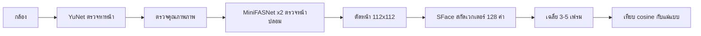

<!-- ร่างโดยผู้ช่วย 2026-10-21 ตาม docs/thesis/draft/_rules.md · Pakon ต้องตรวจและเรียบเรียงใหม่ด้วยภาษาของตัวเองก่อนใช้ในเล่ม -->
<!-- อ้างอิงในเนื้อความใช้รหัส [Rn] ตาม docs/thesis/facts-ch2.md (รายการที่ตรวจแล้ว) · แปลงเป็นรูปแบบของคณะภายหลัง -->
<!-- ผลวัดทุกตัวในบทนี้ใช้เพื่อบอกเหตุผลของการเลือกเท่านั้น · รายละเอียดวิธีวัดและผลเต็มอยู่ในบทที่ 5 -->

# บทที่ 3 เทคโนโลยีที่ใช้ในการศึกษา

บทนี้อธิบายเทคโนโลยีที่ใช้พัฒนาระบบ AI Personal Computer V2 ซึ่งเป็นผู้ช่วย AI ภาษาไทยที่ทำงานบนเครื่อง Raspberry Pi 5 (RAM 8 GB) โดยแต่ละหัวข้อกล่าวถึงว่าเทคโนโลยีนั้นคืออะไร มีจุดเด่นอย่างไร เหตุใดจึงเลือกใช้ในโครงงานนี้ และไลเซนส์ (license หรือเงื่อนไขการอนุญาตให้ใช้งาน) ที่ตรวจแล้ว เทคโนโลยีถูกจัดเป็น 8 กลุ่ม ได้แก่ ภาษาและเฟรมเวิร์ก ฮาร์ดแวร์และระบบปฏิบัติการ ปัญญาประดิษฐ์ในเครื่อง เสียง การประมวลผลภาพใบหน้า ไฮบริดคลาวด์ การควบคุมเบราว์เซอร์ และเครื่องมือพัฒนาและทดสอบ ท้ายบทสรุปไลเซนส์ของทุกส่วนประกอบไว้ในตารางเดียว เนื่องจากโครงงานนี้ตัดสินให้ใช้ในงานศึกษาเท่านั้น จึงใช้ส่วนประกอบที่ห้ามใช้เชิงพาณิชย์ได้ แต่ต้องประกาศไว้ทุกตัว

<!-- ที่มา: docs/adr/0014-licensing.md (การตัดสิน 2026-09-23) -->

## 3.1 ภาษาและเฟรมเวิร์กที่ใช้ในการพัฒนา

### 3.1.1 ภาษา Python

Python เป็นภาษาโปรแกรมระดับสูงที่มีไลบรารีมาตรฐานครอบคลุมงานทั่วไป เช่น การจัดการไฟล์ การเรียกโปรแกรมอื่น (subprocess) การสื่อสารผ่านเครือข่าย และการทดสอบหน่วย (unit test) โครงงานนี้ใช้ Python รุ่น 3.11 ขึ้นไปเป็นภาษาหลักของทุกส่วนที่เป็นตรรกะของระบบ ได้แก่ ตัวเชื่อมหน้าจอ (backend) ตัวคัดเส้นทางข้อความและสกิล ตัวแปลงวันเวลาของนัดหมาย ตัวคุยกับ AI ในเครื่อง ตัวเรียก Claude ตัวควบคุมเบราว์เซอร์ ตัวประมวลผลใบหน้า ตัวช่วยสิทธิ์ root ของหน้าเข้าสู่ระบบ และเครื่องมือวัดผล

เหตุผลที่เลือก Python มี 3 ข้อ ข้อแรก ไลบรารีที่โครงงานต้องใช้ (Qt for Python และ OpenCV) มีรุ่นสำหรับ Python ที่ติดตั้งบน Raspberry Pi OS ได้ ข้อสอง ส่วนเครื่องมือวัดผลตั้งใจเขียนด้วยไลบรารีมาตรฐานอย่างเดียว จึงรันบน Pi ที่เพิ่งติดตั้งระบบปฏิบัติการได้ทันทีโดยไม่ต้องติดตั้งอะไรเพิ่ม ข้อสาม หลักการออกแบบ H6 กำหนดให้งานที่ต้องถูกแน่นอน (วันเวลา การนับ การสั่งเครื่อง และการตัดสินสิทธิ์) ทำด้วยโค้ด ไม่ใช่ด้วย LLM จึงต้องใช้ภาษาที่เขียนเทสต์ครอบคลุมตรรกะเหล่านี้ได้ง่าย ไลบรารีภายนอกแยกเป็นกลุ่มตามหน้าที่ (`ui` สำหรับหน้าจอ และ `vision` สำหรับใบหน้า) เพื่อให้ติดตั้งเฉพาะส่วนที่เครื่องนั้นต้องใช้

<!-- ที่มา: pyproject.toml (requires-python >=3.11 · dependencies = [] · optional-dependencies ui/vision/dev) · CLAUDE.md หลัก H6 -->
<!-- ไลเซนส์ของตัว Python ไม่อยู่ใน ADR-014 → [ต้องเติม: ไลเซนส์ของ Python (ตรวจก่อนระบุ)] -->

### 3.1.2 Qt Quick/QML ผ่าน PySide6

Qt เป็นเฟรมเวิร์กสำหรับสร้างส่วนติดต่อผู้ใช้แบบกราฟิก ส่วน Qt Quick เป็นชุดเครื่องมือของ Qt ที่ใช้ภาษา QML (Qt Modeling Language) ซึ่งเป็นภาษาแบบประกาศ (declarative) สำหรับบรรยายหน้าจอ เช่น ตำแหน่ง สี ภาพเคลื่อนไหว และการตอบสนองต่อการแตะหรือกดแป้น PySide6 หรือ Qt for Python เป็นไลบรารี Qt ทางการสำหรับภาษา Python [R45] ทำให้โค้ด Python ส่งข้อมูลและฟังก์ชันให้หน้าจอ QML เรียกใช้ได้

โครงงานใช้แพ็กเกจ PySide6-Essentials ซึ่งมี Qt Quick/QML ครบแต่มีขนาดเล็กกว่า PySide6 ฉบับเต็ม เพื่อประหยัดพื้นที่บน microSD ของ Pi หลักการแบ่งงานคือ QML ทำหน้าที่วาดหน้าจออย่างเดียว ส่วนการตัดสินใจ ตัวเลข และการตรวจข้อมูลอยู่ใน Python ซึ่งมีเทสต์ หน้าจอตรวจข้อมูลเพื่อแจ้งผู้ใช้ได้เร็วเท่านั้น ผู้ตัดสินจริงคือ backend ตามหลัก H7 สีและขนาดทั้งหมดกำหนดไว้ในไฟล์ `Theme.qml` ที่เดียว รองรับธีมสว่างและมืด และปรับขนาดตัวอักษรได้ 100–200% ฟอนต์ที่ใช้คือ IBM Plex Sans Thai และ IBM Plex Mono ซึ่งฝังมากับแอป

เหตุผลที่เลือก Qt Quick แทนเว็บเบราว์เซอร์หรือชุดเครื่องมืออื่น คือหน้าจอเดียวกันใช้ได้ทั้งเป็นหน้าเข้าสู่ระบบ (greeter) และเป็นหน้าจอหลักหลังเข้าสู่ระบบ ทำงานบน Wayland โดยตรง และเชื่อมกับตรรกะใน Python ได้โดยไม่ต้องเปิดพอร์ตเครือข่ายภายในเครื่อง ไลเซนส์ของ PySide6-Essentials 6.11.2 คือ LGPL-3.0-only OR GPL-2.0-only OR GPL-3.0-only ซึ่งใช้ได้ตามเงื่อนไข LGPL เพราะติดตั้งผ่าน pip และผู้ใช้เปลี่ยนไลบรารีได้ ส่วนฟอนต์ IBM Plex ใช้ SIL Open Font License 1.1

<!-- ที่มา: pyproject.toml (ความเห็นเรื่อง PySide6-Essentials) · docs/ARCHITECTURE.md หัวข้อ "หน้าจอ" · docs/thesis/facts-ch3.md 3.5.2 · docs/adr/0014-licensing.md แถว PySide6 และ IBM Plex · facts-ch2 2.6 -->

### 3.1.3 ไลบรารีเสริมของ Python

นอกจาก PySide6 และ OpenCV (หัวข้อ 3.5) โครงงานใช้ไลบรารีเสริมขนาดเล็กสำหรับงานปฏิทิน ได้แก่ icalendar สำหรับอ่านไฟล์ปฏิทินรูปแบบ .ics และ recurring-ical-events สำหรับกางนัดซ้ำ (รวมนัดที่แก้เฉพาะครั้ง ครั้งที่ถูกลบ และเขตเวลา) ใช้กับฟีเจอร์อ่านปฏิทิน Google แบบอ่านอย่างเดียวผ่านที่อยู่ iCal ลับของผู้ใช้ ไลบรารีทั้งสองเป็น Python ล้วน และไลบรารีที่ติดมาด้วยทั้งหมดถูกตรวจไลเซนส์ก่อนเพิ่ม (ตารางที่ 3.4)

<!-- ที่มา: pyproject.toml (ui = icalendar, recurring-ical-events) · docs/adr/0014-licensing.md แถวการ์ด 0014 · docs/design/0014-calendar.md -->
<!-- [ต้องเติม: ยืนยันว่าฟีเจอร์ปฏิทิน Google (การ์ด 0014) อยู่ในรุ่นที่ส่งจริง · STATUS 2026-10-15 ยังเขียนว่า "สาขา · ยังไม่ติดตั้ง"] -->

## 3.2 ฮาร์ดแวร์ ระบบปฏิบัติการ และการเข้าสู่ระบบ

### 3.2.1 Raspberry Pi 5 และ Raspberry Pi OS

Raspberry Pi 5 เป็นคอมพิวเตอร์บอร์ดเดี่ยวที่ใช้ชิป Broadcom BCM2712 ซึ่งมีหน่วยประมวลผล Arm Cortex-A76 แบบ 64 บิต 4 แกน ความเร็ว 2.4 GHz หน่วยความจำ LPDDR4X-4267 และรับไฟ 5V/5A ผ่าน USB-C [R1] โครงงานนี้ใช้รุ่น RAM 8 GB พร้อม Active Cooler เป็นเครื่องเป้าหมาย งานของ LLM ทั้งหมดรันบน CPU เพราะไม่มี GPU ที่ใช้กับ llama.cpp ได้ จึงต้องอ่านสถานะการลดความเร็วจากความร้อน (`vcgencmd get_throttled`) ทุกครั้งที่วัดผล

ระบบปฏิบัติการคือ Raspberry Pi OS รุ่น Trixie แบบ 64 บิต ซึ่งใช้ฐาน Debian 13 ใช้ Wayland เป็นระบบแสดงผล และใช้ labwc เป็น compositor (โปรแกรมจัดการหน้าต่างและการแสดงผลของ Wayland) [R2] เหตุผลที่เลือกคือเป็นระบบปฏิบัติการหลักของผู้ผลิตบอร์ด มีกลไกของ Linux ที่โครงงานใช้แยกผู้ใช้หลายคนออกจากกัน (บัญชีผู้ใช้ สิทธิ์ไฟล์ PAM และ systemd) อยู่แล้ว โดยไม่ต้องเขียนระบบสิทธิ์ขึ้นเอง

[ภาพที่ 3.1 เครื่อง Raspberry Pi 5 พร้อม Active Cooler กล้อง และไมโครโฟนที่ใช้ในโครงงาน — ต้องเติม: ภาพถ่ายฮาร์ดแวร์จริง]

<!-- ที่มา: facts-ch2 2.1 [R1][R2] · docs/evaluation/results-summary.md หัวข้อ 0 (Raspberry Pi OS trixie 64-bit · Active Cooler) · docs/benchmarks/2026-09-29-pi5-hardware.md -->
<!-- เครื่อง Pi 4 4GB ใช้ตรวจความถูกต้องบน Linux/ARM เท่านั้น ไม่ใช้ตัวเลขความเร็ว (CLAUDE.md) -->

### 3.2.2 greetd และ PAM

greetd เป็นตัวจัดการการเข้าสู่ระบบ (login manager daemon) ขนาดเล็กที่ไม่กำหนดว่าหลังเข้าสู่ระบบต้องเปิดโปรแกรมอะไร และสื่อสารกับหน้าเข้าสู่ระบบ (greeter) ผ่าน IPC แบบ JSON [R8] PAM (Pluggable Authentication Modules) เป็นระบบยืนยันตัวตนแบบต่อโมดูลของ Linux โมดูล `pam_exec` ใช้เรียกโปรแกรมภายนอกระหว่างขั้นยืนยันตัวตนได้ [R34]

ในโครงงานนี้ หน้าเข้าสู่ระบบเป็นแอปของเราเอง (โหมด `--greeter`) ทำงานด้วยผู้ใช้ระบบ `_greetd` และส่งชื่อผู้ใช้กับรหัสผ่านต่อให้ greetd ซึ่งให้ PAM ของระบบปฏิบัติการตรวจ โค้ดของโครงงานไม่ตรวจรหัสผ่านเอง การสแกนใบหน้าเพื่อเข้าเครื่องใช้ `pam_exec` เรียกโปรแกรม `aipc-face-pass` ที่ตรวจตั๋วจากบริการสแกนหน้า `aipc-visiond` และรหัสผ่านยังใช้ได้เสมอ เหตุผลที่เลือก greetd คือเปิดหน้าเข้าสู่ระบบที่เขียนเองได้โดยยังให้ระบบปฏิบัติการเป็นผู้ตัดสินสิทธิ์ ซึ่งตรงกับหลัก H7 greetd ใช้ไลเซนส์ GPL-3.0 โดยโครงงานใช้แพ็กเกจของระบบปฏิบัติการและไม่ได้แก้ไขโค้ด

หน้าจอของหน้าเข้าสู่ระบบแสดงผ่าน cage ซึ่งเป็น compositor ของ Wayland แบบเปิดแอปเดียวเต็มจอ ส่วนการสมัคร กู้คืน และลบบัญชีที่หน้าเข้าสู่ระบบ ทำผ่านคำสั่ง `sudo -n` ที่อนุญาตให้ผู้ใช้ `_greetd` เรียกตัวช่วยสิทธิ์ root ได้ตัวเดียว (`aipc-accounts`) ตัวช่วยนี้ตรวจกฎซ้ำทุกข้อก่อนเรียก `useradd` หรือ `chpasswd`

<!-- ที่มา: docs/ARCHITECTURE.md หัวข้อ "เปิดเครื่องถึงหน้าจอ V2" และ "สมัครบัญชีและลืมรหัสผ่าน" · facts-ch3 3.5.1 · facts-ch2 2.5 [R8][R34] · ADR-014 แถว greetd -->
<!-- [ต้องเติม: ไลเซนส์ของ cage — ไม่อยู่ใน ADR-014] -->

### 3.2.3 labwc

labwc เป็น Wayland compositor แบบซ้อนหน้าต่าง (stacking) ที่ Raspberry Pi OS รุ่น Trixie ใช้เป็นค่าเริ่มต้น labwc รองรับโปรโตคอล ext-session-lock สำหรับล็อกจอ และ ext-idle-notify สำหรับแจ้งเมื่อผู้ใช้ไม่ได้ใช้เครื่อง [R2] [R3]

หลังเข้าสู่ระบบ สคริปต์ `aipc-session` เปิด labwc ด้วยค่าตั้งของโครงงานเอง (สลับหน้าต่างได้ด้วย Alt+Tab เท่านั้น เมนูว่าง และสลับผังแป้นอังกฤษ/ไทยด้วยปุ่ม ~) แล้วเปิดแอปแบบเต็มจอ ถ้าแอปล่มจะถูกเปิดใหม่ และถ้าล่ม 3 ครั้งภายใน 60 วินาทีจะจบเซสชันกลับหน้าเข้าสู่ระบบ เมื่อผู้ใช้กด "ออก" ระบบสั่ง `labwc --exit` เหตุผลที่เลือก labwc คือเป็นของที่มากับระบบปฏิบัติการ และรองรับโปรโตคอลล็อกจอที่สเปกกำหนดว่าถ้าตัวล็อกล่มต้องไม่ปลดล็อก [R4] labwc ใช้ไลเซนส์ GPL-2.0

<!-- ที่มา: docs/ARCHITECTURE.md หัวข้อ "เปิดเครื่องถึงหน้าจอ V2" · facts-ch2 2.1 และ 2.5 · ADR-014 แถว labwc -->

### 3.2.4 systemd

systemd เป็นตัวจัดการบริการ (service manager) ของ Linux ที่เริ่ม หยุด และเฝ้าดูโปรแกรมที่ทำงานเบื้องหลัง โครงงานใช้ systemd ใน 3 ลักษณะ ลักษณะแรก user service คือบริการที่ทำงานในนามผู้ใช้แต่ละคน AI ในเครื่อง (`aipc-llm`) เป็น user service ของผู้ใช้ที่เข้าสู่ระบบอยู่ จึงมีโปรเซสแยกกันต่อผู้ใช้ และเปิดใหม่เองเมื่อล่ม (`Restart=on-failure`) ลักษณะที่สอง การตั้ง `KillUserProcesses=yes` ของ systemd-logind ทำให้เมื่อผู้ใช้ออกจากระบบ ทุกโปรเซสในเซสชันนั้นถูกปิด [R9] ลักษณะที่สาม การจำกัดสิทธิ์ด้วยกลไกของระบบปฏิบัติการ บริการ AI ในเครื่องตั้ง `RestrictAddressFamilies=AF_UNIX` (seccomp ทำให้สร้างได้เฉพาะ Unix socket) และ `PrivateNetwork=yes` (network namespace ที่มีแค่ loopback) จึงต่ออินเทอร์เน็ตไม่ได้ ตัวอ่านออกเสียงและตัวถอดเสียงของคีย์ลัดก็ถูกเรียกในกล่องจำกัดแบบเดียวกัน

เหตุผลที่เลือกคือข้ออ้างว่า "AI ในเครื่องไม่ส่งข้อมูลออกนอกเครื่อง" พิสูจน์ได้ด้วยกลไกของระบบปฏิบัติการ (ตรวจได้จากค่า `Seccomp: 2` ใน `/proc/<pid>/status`) แทนการเชื่อว่าโปรแกรมจะไม่ส่งเอง ข้อจำกัดที่พบคือ `MemoryMax=4G` ในบริการไม่มีผล เพราะ memory cgroup ของเครื่องปิดอยู่ และ `IPAddressDeny=` ไม่มีผลใน user service จึงไม่ใช้

<!-- ที่มา: docs/ARCHITECTURE.md หัวข้อ "AI ในเครื่อง" · facts-ch3 3.5.3 · docs/benchmarks/2026-10-07-llm-netsandbox-pi5/README.md · src/aipc/voice/tts.py (sandboxed) · src/aipc/voice/zipformer.py · facts-ch2 2.5 [R9] -->
<!-- [ต้องเติม: ไลเซนส์ของ systemd — ไม่อยู่ใน ADR-014 (เป็นส่วนของ OS)] -->

### 3.2.5 swayidle และ swaylock

swayidle เป็นโปรแกรมจัดการเหตุการณ์เมื่อไม่ได้ใช้เครื่อง (idle) บน Wayland [R7] ทำงานผ่านโปรโตคอล ext-idle-notify ซึ่งจะไม่นับว่าไม่ได้ใช้เครื่องหากมีโปรแกรมขอระงับ เช่น วิดีโอที่กำลังเล่น [R5] swaylock เป็นโปรแกรมล็อกจอที่ใช้โปรโตคอล ext-session-lock [R6] ซึ่งกำหนดให้ compositor หยุดแสดงผลและหยุดส่งการป้อนข้อมูลให้หน้าต่างอื่นระหว่างล็อก [R4]

แอปเรียก swayidle เพื่อล็อกจอด้วย swaylock เมื่อไม่ได้ใช้ครบเวลาที่ตั้ง (ค่าเริ่มต้น 5 นาที) และออกจากระบบเมื่อล็อกครบอีกช่วงหนึ่ง (ค่าเริ่มต้น 10 นาที) การปลดล็อกใช้รหัสผ่านผ่าน PAM ทั้งสองโปรแกรมใช้ไลเซนส์ MIT เหตุผลที่เลือกคือได้การล็อกที่ปลอดภัยตามสเปกของโปรโตคอลโดยไม่ต้องเขียนตัวล็อกเอง

<!-- ที่มา: docs/ARCHITECTURE.md หัวข้อ "ล็อกเมื่อไม่ได้ใช้" · facts-ch3 3.5.7 · facts-ch2 2.5 · ADR-014 แถว swaylock/swayidle -->

## 3.3 ปัญญาประดิษฐ์ในเครื่อง

### 3.3.1 llama.cpp และ llama-server

llama.cpp เป็นโปรแกรมรัน LLM (Large Language Model) ที่เขียนด้วย C/C++ ทำงานบน CPU ได้ และอ่านโมเดลในรูปแบบไฟล์ GGUF ซึ่งเป็นไฟล์เดียวที่เก็บทุกอย่างที่ต้องใช้รันโมเดล [R21] llama-server เป็นส่วนหนึ่งของ llama.cpp ที่ให้บริการ HTTP ด้วย API แบบเดียวกับ OpenAI รับการเชื่อมต่อผ่าน Unix socket ได้ (ระบุ path ที่ลงท้ายด้วย .sock) และรองรับ function calling เมื่อเปิด `--jinja` [R16]

โครงงาน build llama.cpp บน Pi 5 เอง และให้หน้าจอคุยกับ llama-server ผ่าน Unix socket ใน `$XDG_RUNTIME_DIR/aipc/llm.sock` ซึ่งมีสิทธิ์ 0700 ของผู้ใช้คนนั้น ระบบปฏิบัติการจึงกันผู้ใช้อื่นไม่ให้เชื่อมต่อได้โดยไม่ต้องเขียนโปรโตคอลขึ้นเอง (ADR-008) ค่าที่ใช้คือ `-c 4096 -t 3 -fa off` และบันทึกแคชของ prompt ลงดิสก์ (`--slot-save-path`) ทุกคำขอส่ง `enable_thinking=false` เพราะพบว่าถ้าไม่ปิดโหมดคิด โมเดลจะคิดจนหมดจำนวน token แล้วได้คำตอบว่าง ระบบใช้ function calling ให้ AI ในเครื่องเลือกสกิลหรือเลือกส่งคำถามต่อให้ Claude

ค่าที่เลือกมาจากผลวัดบน Pi 5 ดังนี้ การปิด FlashAttention [R24] เพราะบน CPU ของ Pi 5 ทำให้การสร้างข้อความช้าลง (คำขอยาว 2,048 token จาก 3.68 เหลือ 2.01 token/วินาที วัดกับ Typhoon2.5) การไม่ใช้ speculative decoding แบบ n-gram [R23] เพราะเร็วขึ้นเพียง 1.04 เท่า ต่ำกว่าเกณฑ์ 1.2 เท่าที่ประกาศไว้ และการบันทึกแคชของ prompt ลงดิสก์ ซึ่งลดเวลาข้อความแรกหลังเปิด AI จาก 52.8 วินาที (ไม่มีแคช) เหลือ 0.66–0.72 วินาที โดยโหลดแคชคืนใน 0.24 วินาที llama.cpp ใช้ไลเซนส์ MIT

<!-- ที่มา: docs/ARCHITECTURE.md หัวข้อ "AI ในเครื่อง" · docs/adr/0008-ipc.md · facts-ch2 2.2 [R16][R21][R23][R24] · ADR-014 แถว llama.cpp (commit 86ea01d) -->
<!-- ที่มา: docs/benchmarks/2026-09-30-flash-attn-pi5/README.md · docs/benchmarks/2026-10-01-llm-speed-ideas-pi5/README.md · docs/evaluation/results-summary.md หัวข้อ 0.1 -->

### 3.3.2 รูปแบบ GGUF และการลดความละเอียดแบบ Q4_K_M

Quantization คือการเก็บน้ำหนักของโมเดลด้วยจำนวนบิตที่น้อยลงเพื่อลดขนาดไฟล์และหน่วยความจำ วิธี k-quants ของ llama.cpp แบบ Q4_K เก็บน้ำหนักเป็นกลุ่มใหญ่ (super-block) 8 บล็อก บล็อกละ 32 ค่า โดยมี scale และ min ขนาด 6 บิต รวมเฉลี่ย 4.5 บิตต่อน้ำหนัก ส่วนต่อท้าย `_M` หมายถึงการผสมความละเอียดต่างกันตามชนิดของ tensor [R22] โครงงานใช้ Q4_K_M กับทุกโมเดลที่เปรียบเทียบ เพื่อให้เทียบกันได้ในเงื่อนไขเดียวกันและพอดีกับ RAM 8 GB

<!-- ที่มา: facts-ch2 2.2 [R22] · docs/adr/0007-default-llm.md (GGUF Q4_K_M เหมือนกันทุกตัว) -->

### 3.3.3 โมเดล Gemma 4 E2B และโมเดลที่ประเมิน

Gemma 4 E2B-it เป็นโมเดลภาษาของ Google ตัวอักษร E หมายถึงจำนวนพารามิเตอร์ที่ใช้คำนวณจริง (effective parameters) ซึ่งมี 2.3 พันล้าน (5.1 พันล้านเมื่อรวม embedding) ใช้เทคนิค Per-Layer Embeddings เพื่อให้รันบนอุปกรณ์ได้ รองรับ context 128K และรองรับมากกว่า 35 ภาษา โดยเอกสารของโมเดลไม่ได้ระบุภาษาไทยไว้ชัดเจน [R10] [R11]

ก่อนเลือก โครงงานประเมินผู้สมัคร 3 ตัวที่ใช้ไลเซนส์ Apache-2.0 ทั้งหมด คือ Gemma 4 E2B-it Typhoon2.5-Qwen3-4B ซึ่งปรับจูนภาษาไทยโดย SCB 10X [R12] [R13] และ Qwen3-4B-Instruct-2507 [R14] [R15] ซึ่งเป็นฐานเดียวกับ Typhoon2.5 จึงใช้วัดได้ตรงว่าการปรับจูนภาษาไทยช่วยได้เท่าใด นอกจากนี้ได้ลอง Qwen3-8B ด้วย ผลบนชุดสอบ 100 ข้อบน Pi 5 แสดงในตารางที่ 3.1

ตารางที่ 3.1 ผลเปรียบเทียบโมเดลภาษาบนชุดสอบ 100 ข้อ บน Raspberry Pi 5

| โมเดล (Q4_K_M) | ผ่านตัวตรวจอัตโนมัติ (จาก 100) | บอกตรง ๆ เมื่อไม่มีข้อมูลสด | เวลาเริ่มตอบ (มัธยฐาน) | ความเร็วสร้างข้อความ |
|---|---|---|---|---|
| Gemma 4 E2B-it | 89 | 16/16 | 0.93 วินาที | 5.89 token/วินาที |
| Qwen3-4B-Instruct-2507 | 80 | 9/16 | 2.28 วินาที | 3.33 token/วินาที |
| Typhoon2.5-Qwen3-4B | 72 | 3/16 | 2.31 วินาที | 3.22 token/วินาที |
| Qwen3-8B | ระบบปิดโปรแกรมเพราะ RAM เต็มหลังตอบ 65 ข้อ | — | — | — |

<!-- ที่มา: docs/benchmarks/2026-09-30-exam/README.md · ทุกตัว llama.cpp 86ea01d · 3 thread · -fa off · ปิดโหมดคิด · เครื่องร้อน 80–86°C และถูกลดความเร็วตลอดการวัด (ทุกตัวสภาพเดียวกัน) · ตัวตรวจอัตโนมัติ ยังไม่ใช่คะแนนจากคน -->

แอปใช้ Gemma 4 E2B เป็น AI ในเครื่องตั้งแต่วันที่ 30 กันยายน 2569 เพราะเป็นตัวเดียวที่ผ่านเกณฑ์ความเร็วสร้างข้อความอย่างน้อย 4 token/วินาที เริ่มตอบเร็วที่สุด และได้คะแนนชุดสอบสูงสุด ตัวเลขในตารางวัดขณะเครื่องร้อนและถูกลดความเร็ว จึงเป็นความเร็วที่ได้จริงในเครื่องนี้ ไม่ใช่ความเร็วสูงสุดของ Pi 5 อย่างไรก็ตาม ไม่มีโมเดลใดผ่านเกณฑ์ที่ประกาศไว้ครบทุกข้อ ได้แก่ การไม่ถูกลดความเร็วเมื่อตอบต่อเนื่อง 10 นาทีไม่ผ่านทุกตัวเพราะความร้อน RAM สูงสุดยังไม่ได้วัดโดยตรง และการเลือกสกิลถูกต่ำกว่าเกณฑ์ 80% (Gemma 42/58) การตัดสินอย่างเป็นทางการใน ADR-007 ยังเป็นร่างที่รอยืนยัน รายละเอียดของผลอยู่ในบทที่ 5 Gemma 4 E2B-it ในรูป GGUF ใช้ไลเซนส์ Apache-2.0

<!-- ที่มา: docs/adr/0007-default-llm.md หัวข้อ "หลักฐานที่ใช้ตัดสิน" และ "การตัดสิน" (ร่าง 2026-10-14 · รอ Pakon ยืนยัน) · docs/benchmarks/2026-10-05-thermal/README.md · facts-ch2 2.3 [R10]–[R15] · ADR-014 แถวโมเดล GGUF -->
<!-- [ต้องเติม: ถ้า Pakon ยืนยัน ADR-007 แล้ว ให้เปลี่ยนประโยค "ยังเป็นร่างที่รอยืนยัน"] · วันที่ใช้ปี พ.ศ. 2569 = ค.ศ. 2026 ตรวจรูปแบบวันที่ตามคู่มือคณะ -->

## 3.4 เทคโนโลยีเสียง

ระบบมีทางรับเสียง 2 ทางและทางพูด 1 ทาง ทั้งหมดประมวลผลในเครื่อง ทางแรกคือปุ่มไมโครโฟนในแอปสำหรับพูดประโยคยาวหรือแชท ใช้ whisper.cpp ทางที่สองคือคีย์ลัด (F9 หรือ Alt+Space) สำหรับสั่งงานสั้น ๆ ใช้ Zipformer ผ่าน sherpa-onnx และทางพูดใช้ Piper อ่านออกเสียง เสียงจากไมโครโฟนอัดด้วยโปรแกรม `pw-record` ของ PipeWire แล้วตัดจุดจบเมื่อเงียบประมาณ 1 วินาที

<!-- ที่มา: docs/ARCHITECTURE.md หัวข้อ "เสียง" · src/aipc/voice/stt.py · src/aipc/voice/zipformer.py · docs/design/0019-thai-voice.md · docs/design/0026-voice-precise.md -->
<!-- [ต้องเติม: ไลเซนส์ของ PipeWire/pw-record — ADR-014 ระบุว่ายังไม่ได้ตรวจ] -->

### 3.4.1 whisper.cpp และ Thonburian Whisper

Whisper เป็นโมเดลถอดเสียงเป็นข้อความที่ฝึกด้วยข้อมูลเสียงจำนวนมากแบบ weak supervision [R41] Distil-Whisper ย่อขนาดโมเดลด้วย knowledge distillation [R42] และ Thonburian Whisper เป็น Whisper ที่ปรับจูนและย่อขนาดสำหรับภาษาไทย [R43] whisper.cpp เป็นโปรแกรมรันโมเดล Whisper ด้วย C/C++ บน CPU

ปุ่มไมโครโฟนในแอปใช้ whisper.cpp กับโมเดล Thonburian distill-small แบบ f16 ซึ่งแปลงเป็นรูปแบบ ggml เอง และใช้ตัวเลือก `-ac 512` (ลดขนาดหน้าต่างเสียงที่ encoder ประมวลผล) ข้อความที่ถอดได้จะใส่ในช่องพิมพ์ให้ผู้ใช้ตรวจก่อน ไม่ส่งเอง เหตุผลที่เลือกรุ่นนี้คือบน Pi 5 รุ่น medium ช้าเกินเกณฑ์ (11–14 วินาทีต่อประโยค) ขณะที่ distill-small แบบ f16 กับ `-ac 512` ถอดได้มัธยฐาน 2.14 วินาทีต่อประโยค (ช้าสุด 2.63 วินาที) ผ่านเกณฑ์ไม่เกิน 5 วินาที ผลนี้วัดด้วยเสียงสังเคราะห์ 10 ประโยค จึงอ้างได้เฉพาะความเร็ว whisper.cpp และโมเดล Thonburian distill-small ใช้ไลเซนส์ MIT

<!-- ที่มา: facts-ch2 2.8 [R41][R42][R43] · docs/benchmarks/2026-10-01-voice-small/README.md (distill-small f16 -ac 512: 2.14 / 2.63 วิ · เสียงสังเคราะห์) · docs/benchmarks/2026-10-01-voice-pi5/README.md (medium) · ADR-014 แถว whisper.cpp และ Thonburian -->
<!-- หมายเหตุ: results-summary 0.5 เขียน "2.80 วิ (f16)" ซึ่งเป็นแถวของ small ไม่ใช่ distill-small → ใช้ค่าจาก README ต้นฉบับ -->

### 3.4.2 Zipformer และ sherpa-onnx

Zipformer เป็นโมเดลรู้จำเสียงพูด ซึ่งโครงงานใช้รุ่นภาษาไทยที่ฝึกด้วยชุดข้อมูล GigaSpeech2 ส่วน sherpa-onnx เป็นไลบรารีสำหรับรันโมเดลรู้จำเสียงในรูป ONNX ผ่าน onnxruntime รองรับ hotwords คือรายการคำที่ให้น้ำหนักพิเศษระหว่างถอดเสียง

คีย์ลัดเสียงใช้ Zipformer กับ hotwords ที่เป็นประโยคคำสั่งเต็ม (น้ำหนัก ×5) เหตุผลมาจากการเทียบ 9 แบบบน Pi 5 ด้วยกติกาที่ประกาศก่อนวัด (ตัดตัวที่ช้ากว่า 1.5 วินาทีหรือใช้ RAM เกิน 1 GB แล้วเลือกตัวที่ทำผิดน้อยที่สุด) Zipformer กับ hotwords ทำคำสั่งถูก 50 จาก 64 ข้อในชุดพัฒนา (whisper distill-small แบบเดิม 39 ข้อ) ไม่ทำคำสั่งกับประโยคที่ไม่ใช่คำสั่งเลย (0/38) ใช้เวลามัธยฐาน 0.16 วินาที และใช้ RAM 329 MB เทียบกับ whisper ที่ 0.82 วินาทีและ 663 MB ผลชุดนี้ใช้เสียงสังเคราะห์และวัดขณะเครื่องร้อน จึงใช้เพื่อคัดเลือกเท่านั้น ส่วนความแม่นยำของฟีเจอร์คีย์ลัดเสียงยังไม่ผ่านเกณฑ์ที่ประกาศไว้ (รายงานในบทที่ 5) ส่วนปุ่มไมโครโฟนในแอปยังใช้ whisper เหมือนเดิม

ไลเซนส์ของ sherpa-onnx 1.13.8 และน้ำหนักโมเดล Zipformer คือ Apache-2.0 แต่ข้อมูลที่ใช้ฝึก (GigaSpeech2) มีเงื่อนไขการเข้าถึงสำหรับการวิจัยและการศึกษาที่ไม่ใช่เชิงพาณิชย์ โครงงานจึงถือว่าส่วนนี้ใช้เชิงพาณิชย์ไม่ได้ onnxruntime ใช้ไลเซนส์ MIT

<!-- ที่มา: docs/benchmarks/2026-10-14-voice-models/README.md (ตาราง 9 แถว · กติกาการ์ด 0026 หัวข้อ 7 · เสียงสังเคราะห์ Piper · เครื่องร้อน 82–85°C) · src/aipc/voice/zipformer.py · docs/STATUS.md แถวการ์ด 0026 · ADR-014 แถว sherpa-onnx · Zipformer · onnxruntime -->
<!-- ชื่อโมเดล: yfyeung/icefall-asr-gigaspeech2-th-zipformer-2024-06-20 · Zipformer/sherpa-onnx/GigaSpeech2 ไม่มีในรายการอ้างอิงที่ตรวจแล้ว [ต้องเติม: Pakon หาแหล่งอ้างอิงที่ตรวจแล้วก่อนอ้าง] -->

### 3.4.3 Piper

Piper เป็นโปรแกรมสังเคราะห์เสียงพูดจากข้อความ (text-to-speech) แบบเครือข่ายประสาทที่ทำงานในเครื่องและเร็ว [R44] โครงงานใช้เสียงภาษาไทย `th_TH-tsync2-medium` และเสียงภาษาอังกฤษ `en_US-ljspeech-medium` โดยโหลดค้างไว้ในโปรเซสแยก เหตุผลคือถ้าเปิดโปรแกรมใหม่ทุกครั้งใช้เวลา 6.3 วินาที แต่เมื่อโหลดค้างไว้อ่านได้ 0.4–0.8 วินาทีต่อประโยค (ประโยคแรก 3.8 วินาที) ผ่านเกณฑ์ไม่เกิน 2 วินาที และเสียงไทยนี้เป็นเสียงไทยตัวเดียวที่มีสำหรับ Piper จึงไม่ได้เปรียบเทียบตัวสังเคราะห์เสียงอื่นด้วยตัวเลข

ระหว่างทดสอบพบว่า onnxruntime ที่อยู่ใน Piper ส่งข้อมูล telemetry ออกนอกเครื่องได้เอง จึงแก้ให้ Piper ทำงานในกล่องที่ต่อเครือข่ายไม่ได้ (หัวข้อ 3.2.4) และตรวจซ้ำแล้วว่าไม่มีการเชื่อมต่อออก ไลเซนส์ของ piper-tts 1.8.0 คือ GPL-3.0-or-later (แอปเรียกเป็นโปรเซสแยก) เสียงไทย `th_TH-tsync2-medium` ใช้ไลเซนส์ CC BY-NC-SA 3.0 ซึ่งห้ามใช้เชิงพาณิชย์ และตัวแปลงหน่วยเสียงไทย tltk ใช้ไลเซนส์ BSD-3-Clause

<!-- ที่มา: docs/benchmarks/2026-10-01-voice-pi5/README.md (6.3 วิ · 0.4–0.8 วิ · ประโยคแรก 3.8 วิ) · docs/adr/0006-tts.md · docs/benchmarks/2026-10-08-t6-new-pi5/README.md · docs/benchmarks/2026-10-09-t6-rerun-pi5/README.md · facts-ch2 2.8 [R44] · ADR-014 แถว piper-tts · th_TH-tsync2-medium · en_US-ljspeech-medium · tltk · espeak-ng -->
<!-- [ต้องเติม: ยืนยันว่าเสียงอังกฤษ en_US-ljspeech-medium และ whisper base.en (การ์ด 0039/0040) อยู่ในรุ่นที่ส่ง · STATUS 2026-10-19 เขียนว่าติดตั้งใน /opt/aipc-voice แล้ว · ถ้าใส่ ให้เพิ่ม whisper base.en (MIT) ในตารางที่ 3.4] -->

## 3.5 เทคโนโลยีการประมวลผลภาพและใบหน้า

### 3.5.1 OpenCV

OpenCV เป็นไลบรารีด้านคอมพิวเตอร์วิทัศน์ที่มีโมดูล DNN สำหรับรันโมเดลเครือข่ายประสาท โครงงานใช้แพ็กเกจ opencv-python-headless ซึ่งไม่มีส่วนแสดงหน้าต่างของตัวเองจึงมีขนาดเล็กกว่า และรันโมเดลใบหน้าทั้ง 3 ชนิดในหัวข้อถัดไปได้ในตัว เหตุผลที่เลือกคือไม่ต้องเพิ่มตัวรันโมเดลอื่นหรือเปิดบริการผ่านพอร์ตเครือข่าย ซึ่งช่วยประหยัด RAM ของ Pi ตามหลัก H4 โมเดลทุกตัวโหลดผ่าน OpenCV และตรวจค่า sha256 ทุกครั้งก่อนใช้ งานกล้องทำในเธรดแยกจากหน้าจอ opencv-python-headless 5.0.0.93 ใช้ไลเซนส์ Apache-2.0 และใช้ numpy (BSD-3-Clause และไลเซนส์อื่นที่ระบุในตารางที่ 3.2) ในการคำนวณเวกเตอร์

ขั้นตอนประมวลผลใบหน้าของระบบเรียงตามภาพที่ 3.2 คือ ตรวจหาหน้าด้วย YuNet ตรวจคุณภาพภาพ ตรวจหน้าปลอมด้วย MiniFASNet 2 ตัว ตัดภาพหน้าขนาด 112×112 จุด สกัดเวกเตอร์ด้วย SFace เฉลี่ยจาก 3–5 เฟรม แล้วเทียบกับแม่แบบด้วยค่า cosine แม่แบบที่เก็บเป็นตัวเลข 128 ค่า พร้อมบันทึกความยินยอมและค่า sha256 ของโมเดล และไม่เก็บภาพ

[ภาพที่ 3.2 ขั้นตอนประมวลผลใบหน้าด้วย OpenCV — ต้องเติม: แปลงแผนภาพ Mermaid ด้านบนเป็นรูป]

<!-- ที่มา: pyproject.toml (vision = opencv-python-headless, numpy · ไม่ใช้ onnxruntime/FastAPI) · docs/ARCHITECTURE.md หัวข้อ "ใบหน้า" · facts-ch3 3.5.5 · ADR-014 แถว opencv-python-headless และ numpy -->

### 3.5.2 YuNet

YuNet เป็นตัวตรวจหาใบหน้าแบบ anchor-free ที่ออกแบบสำหรับอุปกรณ์ขนาดเล็ก มีพารามิเตอร์ 75,856 ตัว [R25] ระบบใช้ YuNet หาตำแหน่งใบหน้าในทุกภาพจากกล้อง ทั้งในการลงทะเบียนใบหน้า การสแกนเข้าเครื่อง และตัวตรวจว่าเจ้าของยังนั่งอยู่ เหตุผลที่เลือกคือขนาดเล็กพอที่จะรันบน CPU ของ Pi ได้บ่อยและมีในชุดโมเดลของ OpenCV โมเดล YuNet ใช้ไลเซนส์ MIT

<!-- ที่มา: facts-ch2 2.4 [R25] · docs/ARCHITECTURE.md · ADR-014 แถว YuNet -->

### 3.5.3 SFace

SFace เป็นโมเดลสกัดลักษณะเด่นของใบหน้า (face embedding) ที่ฝึกด้วยฟังก์ชัน loss แบบ sigmoid-constrained hypersphere ซึ่งคุมแรงดึงภายในคลาสและระหว่างคลาสให้พอดีเพื่อลด overfitting [R26] ตัวอย่างของ OpenCV กำหนดว่าค่า cosine ตั้งแต่ 0.363 ขึ้นไปถือเป็นคนเดียวกัน [R27] ระบบใช้ค่านี้ทั้งการสแกนเข้าเครื่องและตัวตรวจว่าเจ้าของยังนั่งอยู่ เมื่อวัดด้วยโพรโทคอลมาตรฐานของชุดข้อมูล LFW [R29] (6,000 คู่ 10 ชุด) ร่วมกับ YuNet ได้ความแม่นยำ 99.35% ± 0.37% ระบบใช้ SFace แบบ fp32 ซึ่งใช้ไลเซนส์ Apache-2.0

<!-- ที่มา: facts-ch2 2.4 [R26][R27][R29] · docs/benchmarks/2026-09-24-face-lfw-standard/README.md (99.35% ± 0.37% · วัดบนวินโดวส์ · ความแม่นยำไม่ขึ้นกับเครื่อง · ระดับหลักฐาน 3) · docs/benchmarks/2026-09-24-face-sface-int8/README.md (เหตุผลที่ใช้ fp32 · วัดบน Pi 4 จึงไม่ยกตัวเลขความเร็วมาในบทนี้) · ADR-014 แถว SFace -->
<!-- ข้อจำกัดที่ต้องเขียนในบทที่ 5: LFW ≠ กล้องจริง · คนใน LFW อาจอยู่ในชุดฝึกของ SFace (results-summary หัวข้อข้อจำกัด) -->

### 3.5.4 MiniFASNet

MiniFASNet มาจากโครงการ Silent-Face-Anti-Spoofing ของ Minivision เป็นโมเดลตรวจหน้าปลอม (Presentation Attack Detection, PAD) ที่ย่อจาก MobileFaceNet และใช้สเปกตรัมฟูเรียร์ช่วยฝึก [R28] ระบบใช้ MiniFASNet 2 ตัวร่วมกันเพื่อกันการโจมตีแบบง่าย เช่น การยื่นภาพถ่ายใบหน้าต่อกล้อง เหตุผลที่เลือกคือมีขนาดเล็กและรันผ่าน OpenCV ได้ ข้อจำกัดคือบนกล้อง RGB กันได้เฉพาะการโจมตีแบบง่าย และยังไม่ได้วัดค่า APCER ตามมาตรฐาน ISO/IEC 30107-3 [R30] ด้วยเหตุนี้การสแกนหน้าเข้าเครื่องจึงเป็นตัวเลือกที่ผู้ใช้เปิดเองต่อบัญชี และรหัสผ่านใช้ได้เสมอ MiniFASNet ใช้ไลเซนส์ Apache-2.0

<!-- ที่มา: facts-ch2 2.4 [R28][R30] · docs/THREAT_MODEL.md T2 · facts-ch3 3.3 · ADR-014 แถว MiniFASNet -->

## 3.6 เทคโนโลยีไฮบริดคลาวด์

### 3.6.1 Claude Code (`claude -p`)

Claude Code เป็นเครื่องมือของ Anthropic ที่ให้ผู้ใช้สั่งงานโมเดล Claude จากบรรทัดคำสั่ง โหมด `claude -p` เป็นโหมดไม่โต้ตอบ ซึ่งอ่าน prompt ทำงานจนจบ พิมพ์ผล แล้วออก และรายงานค่าใช้จ่ายโดยประมาณได้ [R39] ระบบใช้ Claude Code ใน 2 งาน งานแรกคือส่งต่อคำถามที่ AI ในเครื่องตอบไม่ได้ เช่น ข้อมูลสด โดยเปิดเครื่องมือค้นเว็บ (WebSearch) อย่างเดียว ส่งคำถามพร้อมข้อความล่าสุดไม่เกิน 4 ข้อความ และไม่ส่งไฟล์ นัด ใบหน้า หรือชื่อบัญชี งานที่สองคือให้ Claude สร้างสกิลเป็นไฟล์ `.md` โดยไม่มีเครื่องมือใด ๆ และไฟล์ที่ได้ต้องผ่านตัวตรวจของโค้ดก่อนติดตั้ง

ทุกครั้งที่เรียก ระบบรัน Claude Code จากโฟลเดอร์ว่าง ไม่เก็บบทสนทนา (`--no-session-persistence`) กำหนดเพดานเงินต่อครั้ง (`--max-budget-usd`) และบันทึกข้อความที่ส่งออกจริงลงไฟล์ `outbound.json` ที่ผู้ใช้เปิดดูและล้างได้ในหน้าตั้งค่า มีเพดานเงินต่อวันที่ผู้ใช้เลือกได้ (ค่าเริ่มต้น 1 ดอลลาร์สหรัฐ) เมื่อครบเพดาน AI ในเครื่องยังใช้งานได้ ผู้ใช้ปิดการใช้ Claude ได้ด้วยสวิตช์ในหน้าตั้งค่า แต่ละบัญชีติดตั้งและเข้าสู่ระบบ Claude Code ของตัวเองแยกกัน ระบบไม่ใช้ตัวเลือก `--bare` เพราะตัวเลือกนี้ไม่ใช้การเข้าสู่ระบบแบบ subscription [R39]

เหตุผลที่เลือก Claude Code แทนการเรียก API โดยตรง คือผู้ใช้เข้าสู่ระบบด้วยบัญชีของตนเองได้โดยไม่ต้องจัดการกุญแจ API ในเครื่อง และควบคุมเครื่องมือที่ Claude ใช้ได้ด้วยตัวเลือกของบรรทัดคำสั่ง Claude Code และบริการของ Anthropic ใช้งานตามข้อตกลงของบัญชี ไม่ใช่ไลเซนส์ซอฟต์แวร์เปิด และยังไม่ได้ตรวจเงื่อนไขอย่างละเอียด

<!-- ที่มา: docs/ARCHITECTURE.md หัวข้อ "ไฮบริด" · facts-ch3 3.5.6 · src/aipc/cloud/ask.py (--tools WebSearch · --model sonnet · --no-session-persistence · --max-budget-usd) · facts-ch2 2.9 [R39] · docs/design/0016-hybrid-cloud.md · docs/design/0021-claude-setup-guide.md · ADR-014 หัวข้อ "ยังไม่ได้ตรวจ" -->
<!-- facts-ch3 ระบุเพดาน $0.50/คำถาม และ $1.00/การสร้างสกิล 1 ครั้ง · ไม่ได้ใส่ตัวเลขในเนื้อความเพราะค่าอาจเปลี่ยนตามรุ่น [ต้องเติม: ตรวจค่าใน src/aipc/cloud/ask.py และ forge ของรุ่นที่ส่งก่อนใส่] -->

### 3.6.2 Open-Meteo

Open-Meteo เป็นบริการข้อมูลพยากรณ์อากาศที่ให้ข้อมูลภายใต้ไลเซนส์ CC BY 4.0 (ต้องให้เครดิต) และแบบใช้ฟรีจำกัดไม่เกิน 10,000 ครั้งต่อวัน [R40] ระบบเรียก Open-Meteo ด้วย urllib ของ Python เมื่อผู้ใช้ถามเรื่องอากาศ โดยส่งเพียงชื่อเมืองหรือพิกัด และบันทึกการส่งออกเช่นเดียวกับ Claude เหตุผลที่เลือกคือใช้ได้โดยไม่ต้องสมัครหรือใช้กุญแจ API ยังไม่ได้ตรวจเงื่อนไขการใช้ API เชิงพาณิชย์

<!-- ที่มา: facts-ch2 2.9 [R40] · docs/ARCHITECTURE.md หัวข้อ "ไฮบริด" · ADR-014 แถว Open-Meteo -->
<!-- facts-ch3 (2026-10-07) เขียนว่า "อากาศไม่มีสวิตช์" แต่ STATUS 2026-10-07 แถวแผงความเป็นส่วนตัวเขียนว่าเพิ่ม "สวิตช์อากาศ" แล้ว → [ต้องเติม: ตรวจในแอปรุ่นที่ส่งว่ามีสวิตช์ปิดอากาศหรือไม่ ก่อนเขียนเรื่องนี้] -->

## 3.7 เทคโนโลยีการควบคุมเบราว์เซอร์

### 3.7.1 Chromium

Chromium เป็นเว็บเบราว์เซอร์แบบโอเพนซอร์สที่ติดตั้งมากับ Raspberry Pi OS ระบบใช้ Chromium เปิดเว็บที่ผู้ใช้สั่ง และเป็นเบราว์เซอร์ของผู้ช่วยที่รับคำสั่งเสียง เช่น ค้นหา เลื่อนหน้า ย้อนกลับ ปิดแท็บ หรือกดปุ่มตามสกิลประจำเว็บ แอปเปิด Chromium เองด้วยโปรไฟล์แยกในโฟลเดอร์ของผู้ใช้ (`~/.local/share/aipc/browser`) และตั้งให้ใช้ `--password-store=basic` เพราะเมื่อเข้าเครื่องด้วยใบหน้า keyring ของผู้ใช้จะไม่ถูกปลดล็อก ความเสี่ยงที่ตามมาคือข้อมูลการเข้าสู่ระบบเว็บอ่านได้หากถอด microSD ไปอ่าน ซึ่งเป็นความเสี่ยงที่ยอมรับและบันทึกไว้ในแบบจำลองภัย

<!-- ที่มา: src/aipc/browser/control.py (docstring) · docs/ARCHITECTURE.md หัวข้อ "เบราว์เซอร์" · docs/THREAT_MODEL.md T4 · facts-ch3 3.4 แถวเบราว์เซอร์ · docs/design/0024-voice-browser.md -->
<!-- [ต้องเติม: ไลเซนส์ของ Chromium — ADR-014 ระบุว่ายังไม่ได้ตรวจ · Widevine CDM ที่มากับ OS เป็นไลเซนส์กรรมสิทธิ์ของ Google] -->

### 3.7.2 Chrome DevTools Protocol ผ่าน `--remote-debugging-pipe`

Chrome DevTools Protocol (CDP) เป็นโปรโตคอลที่โปรแกรมภายนอกใช้สั่งงานและอ่านสถานะของ Chromium เช่น เปิด URL รันสคริปต์ในหน้าเว็บ และอ่านตำแหน่งการเลื่อนหน้า วิธีที่พบทั่วไปคือเปิดพอร์ตดีบัก (เช่น 9222) ซึ่งทุกโปรแกรมและทุกบัญชีในเครื่องเชื่อมต่อได้ โครงงานนี้จึงเปิด Chromium ด้วย `--remote-debugging-pipe` แทน ซึ่ง Chromium อ่านคำสั่งจาก file descriptor หมายเลข 3 และตอบทางหมายเลข 4 ข้อความเป็น JSON คั่นด้วยอักขระ \0 วิธีนี้ไม่เปิดพอร์ตเครือข่าย มีเพียงโปรเซสที่เปิด Chromium (แอปของผู้ใช้คนนั้น) เท่านั้นที่ควบคุมได้

เหตุผลที่เลือกคือรักษาหลักที่ว่าโปรแกรมของโครงงานไม่เปิดพอร์ตเครือข่าย และสอดคล้องกับการแยกผู้ใช้ด้วยระบบปฏิบัติการ ทุกคำสั่งตรวจผลจากหน้าเว็บจริง (เช่น URL หรือตำแหน่งการเลื่อน) ก่อนตอบผู้ใช้ ตามหลัก H5 ตัวสื่อสารทาง pipe เขียนด้วยไลบรารีมาตรฐานของ Python จึงไม่ต้องเพิ่ม dependency

<!-- ที่มา: src/aipc/browser/cdp.py (docstring: fd 3/4 · JSON คั่นด้วย \0 · พอร์ต 9222 = ทุกโปรแกรม/ทุกบัญชีต่อได้) · src/aipc/browser/control.py · CLAUDE.md โครงสร้างโค้ด (browser/ ไม่มีพอร์ต) · facts-ch3 3.1 (ไม่มีโปรแกรมของเราเปิดพอร์ตเครือข่าย) -->
<!-- CDP ไม่มีในรายการอ้างอิงที่ตรวจแล้ว [ต้องเติม: Pakon หาแหล่งอ้างอิงเอกสาร Chrome DevTools Protocol ที่ตรวจแล้วก่อนอ้าง] -->

## 3.8 เครื่องมือพัฒนาและทดสอบ

### 3.8.1 unittest

unittest เป็นโมดูลทดสอบหน่วยที่มากับไลบรารีมาตรฐานของ Python โครงงานเขียนเทสต์ด้วย unittest และรันทั้งชุดด้วยคำสั่ง `python -m unittest discover -s tests -t .` ก่อน commit ทุกครั้ง เทสต์ชุดเดียวกันรันทั้งบนเครื่องพัฒนาวินโดวส์และบน Pi 5 เทสต์ที่ต้องใช้ Linux จะถูกข้ามบนวินโดวส์ และนับแยกจากเทสต์ที่ผ่าน ตัวอย่างล่าสุดที่บันทึกไว้คือ 1,154 ข้อผ่าน ข้าม 18 ข้อบนวินโดวส์ และ 1,154 ข้อผ่านไม่ข้ามเลยบน Pi 5 เหตุผลที่เลือกคือไม่ต้องติดตั้งเพิ่ม และรันบน Pi ได้ทันที

<!-- ที่มา: CLAUDE.md หัวข้อคำสั่ง · docs/STATUS.md บรรทัด 2026-10-21 (วินโดวส์ 1154 ผ่าน ข้าม 18 · Pi 5 `49a0d77` 1154 ผ่าน ไม่ข้าม · สาขา feature/0046-site-skills) -->
<!-- [ต้องเติม: อัปเดตจำนวนเทสต์เป็นของ commit รุ่นที่ส่งจริง] -->

### 3.8.2 ruff

ruff เป็นเครื่องมือตรวจรูปแบบและข้อผิดพลาดที่พบบ่อยของโค้ด Python (linter) และจัดรูปแบบโค้ด (formatter) โครงงานตั้งความยาวบรรทัดไม่เกิน 100 ตัวอักษร และเปิดกฎกลุ่ม E F W I B และ UP ต้องผ่านทั้ง `ruff check` และ `ruff format --check` ก่อน commit สคริปต์ที่อยู่ในโฟลเดอร์ผลวัดถูกยกเว้นจากการจัดรูปแบบ เพราะเป็นหลักฐานที่ commit ก่อนวัดและห้ามแก้ภายหลัง

<!-- ที่มา: pyproject.toml ([tool.ruff] · extend-exclude docs/benchmarks) · CLAUDE.md หัวข้อคำสั่ง -->
<!-- [ต้องเติม: ไลเซนส์ของ ruff — ไม่อยู่ใน ADR-014] -->

### 3.8.3 git

git เป็นระบบควบคุมเวอร์ชัน โครงงานใช้ git เก็บทุกการเปลี่ยนแปลงของโค้ดและเอกสารแบบทีละเรื่อง เพื่อย้อนกลับได้และระบุได้ว่าผลวัดแต่ละชุดมาจากโค้ดรุ่นใด (commit) ฟีเจอร์ใหม่พัฒนาบนสาขาของตัวเองและรวมเข้าสาขาหลักเมื่อผ่านเกณฑ์ในการ์ดออกแบบ การส่งโค้ดขึ้น Pi ใช้ `git bundle` ซึ่งรวมประวัติเป็นไฟล์เดียวแล้วคัดลอกไปด้วย scp จึงไม่ต้องให้ Pi เชื่อมต่อกับบริการเก็บโค้ดภายนอก นอกจากนี้ git ยังใช้ยืนยันหลัก H9 คือเกณฑ์ ชุดข้อมูล และสคริปต์วัดผลต้อง commit ก่อนรันจริง

การติดตั้งแอปบน Pi ใช้แนวทางเดียวกัน คือแตกโค้ดแต่ละรุ่นไว้ในโฟลเดอร์ `/opt/aipc-releases/<commit>` พร้อมสภาพแวดล้อม Python (venv) ของตัวเอง แล้วสลับลิงก์ `/opt/aipc-v2` ไปยังรุ่นใหม่หลังทดลองเปิดหน้าเข้าสู่ระบบผ่าน การย้อนรุ่นจึงทำได้ด้วยคำสั่งเดียวโดยไม่ต้องใช้อินเทอร์เน็ต (ADR-009)

<!-- ที่มา: CLAUDE.md หัวข้อ git และการส่งโค้ดขึ้น Pi · docs/adr/0009-app-update-rollback.md · docs/ARCHITECTURE.md (update-app.sh) · facts-ch3 3.6 (ประกาศเกณฑ์ก่อนวัด) -->

### 3.8.4 เครื่องมือวัดผลที่พัฒนาขึ้นในโครงงาน

โครงงานพัฒนาเครื่องมือวัดผลของตัวเอง 3 กลุ่ม กลุ่มแรก `aipc.bench` ใช้จับเวลาตามกติกาของโครงงาน คือ warm-up 1 รอบแล้ววัดอย่างน้อย 5 รอบ รายงานมัธยฐานและ p95 แบบ nearest-rank บันทึกค่าดิบเป็นไฟล์ .csv .json และ .md และไม่เขียนทับผลเดิม กลุ่มที่สอง `aipc.doctor` ใช้ตรวจสภาพเครื่องแบบอ่านอย่างเดียว เช่น บอร์ด RAM ไฟเลี้ยง ความร้อน ที่เก็บข้อมูล กล้อง และเสียง โดยรายงานผลเป็น ผ่าน เตือน ไม่ผ่าน หรือไม่รู้ กลุ่มที่สาม ตัววัดเฉพาะเรื่องในแพ็กเกจ `aipc.spikes` เช่น ชุดสอบของ LLM ตัวเลือกสกิล และการตรวจการเชื่อมต่อขาออก เครื่องมือเหล่านี้ทำให้ผลวัดทุกชุดตรวจย้อนได้ และแยกผลที่วัดบน Pi 5 ซึ่งนับเป็นหลักฐานระดับ 4 ออกจากผลบนเครื่องพัฒนา

<!-- ที่มา: facts-ch3 3.7 · docs/ARCHITECTURE.md หัวข้อ "เครื่องมือเฟส 0" · docs/TESTING.md -->

## 3.9 สรุปไลเซนส์ของส่วนประกอบ

ตารางที่ 3.2 ถึง 3.4 สรุปไลเซนส์ของส่วนประกอบหลักที่ใช้ในโครงงานจากการตรวจของโครงงาน (ADR-014) คอลัมน์ "ใช้เชิงพาณิชย์ได้" ใช้ตอบคำถามว่าถ้าจะนำระบบไปใช้จริงหรือแจกจ่ายต้องเปลี่ยนส่วนใด ส่วนประกอบที่ยังไม่ได้ตรวจไลเซนส์จะระบุว่ายังไม่ได้ตรวจ ไม่ได้เดาไลเซนส์ให้

ตารางที่ 3.2 ไลเซนส์ของซอฟต์แวร์ระบบและเฟรมเวิร์ก

| ส่วนประกอบ | หน้าที่ในระบบ | ไลเซนส์ | ใช้เชิงพาณิชย์ได้ |
|---|---|---|---|
| PySide6-Essentials 6.11.2 | หน้าจอ Qt Quick/QML | LGPL-3.0-only OR GPL-2.0-only OR GPL-3.0-only | ได้ตามเงื่อนไข LGPL |
| IBM Plex Sans Thai / Mono | ฟอนต์ของแอป | SIL Open Font License 1.1 | ได้ (ห้ามขายตัวฟอนต์แยก) |
| greetd | ตัวจัดการการเข้าสู่ระบบ | GPL-3.0 | ได้ แต่ต้องเปิดซอร์สถ้าแจกจ่าย |
| labwc | Wayland compositor | GPL-2.0 | ได้ แต่ต้องเปิดซอร์สถ้าแจกจ่าย |
| swaylock / swayidle | ล็อกจอ / จับการไม่ได้ใช้เครื่อง | MIT | ได้ |
| llama.cpp | รัน LLM ในเครื่อง | MIT | ได้ |
| opencv-python-headless 5.0.0.93 | รันโมเดลใบหน้า | Apache-2.0 | ได้ |
| numpy 2.5.3 | คำนวณเวกเตอร์ | BSD-3-Clause AND 0BSD AND MIT AND Zlib AND CC0-1.0 | ได้ |
| whisper.cpp | ถอดเสียง (ปุ่มไมโครโฟน) | MIT | ได้ |
| sherpa-onnx 1.13.8 | ถอดเสียง (คีย์ลัด) | Apache-2.0 | ได้ |
| onnxruntime 1.30.0 | ตัวรันโมเดลของ Piper และ sherpa-onnx | MIT | ได้ |
| piper-tts 1.8.0 (รวม espeak-ng) | อ่านออกเสียง | GPL-3.0-or-later | ได้ แต่ต้องเปิดซอร์สถ้าแจกจ่าย |
| tltk 1.11 | แปลงหน่วยเสียงไทยของ Piper | BSD-3-Clause | ได้ |

ตารางที่ 3.3 ไลเซนส์ของโมเดลและข้อมูล

| ส่วนประกอบ | หน้าที่ในระบบ | ไลเซนส์ | ใช้เชิงพาณิชย์ได้ |
|---|---|---|---|
| Gemma 4 E2B-it (GGUF) | AI ในเครื่อง | Apache-2.0 | ได้ |
| Typhoon2.5-Qwen3-4B และ Qwen3-4B-Instruct-2507 (GGUF) | โมเดลที่ประเมินเปรียบเทียบ | Apache-2.0 | ได้ |
| Thonburian distill-small | ถอดเสียงภาษาไทย | MIT | ได้ |
| Zipformer ไทย (GigaSpeech2) | ถอดเสียงคำสั่ง | น้ำหนัก Apache-2.0 · ข้อมูลฝึกจำกัดเพื่อการวิจัยและการศึกษา | ไม่แน่ใจ จึงถือว่าไม่ได้ |
| เสียง Piper th_TH-tsync2-medium | เสียงอ่านภาษาไทย | CC BY-NC-SA 3.0 | ไม่ได้ |
| เสียง Piper en_US-ljspeech-medium | เสียงอ่านภาษาอังกฤษ | ชุดข้อมูล public domain · repo MIT | ได้ |
| YuNet | ตรวจหาใบหน้า | MIT | ได้ |
| SFace | สกัดเวกเตอร์ใบหน้า | Apache-2.0 | ได้ |
| MiniFASNet | ตรวจหน้าปลอม | Apache-2.0 | ได้ |

ตารางที่ 3.4 ไลบรารีเสริมและบริการภายนอก

| ส่วนประกอบ | หน้าที่ในระบบ | ไลเซนส์ / เงื่อนไข | ใช้เชิงพาณิชย์ได้ |
|---|---|---|---|
| icalendar 7.3.0 | อ่านไฟล์ปฏิทิน .ics | BSD-2-Clause | ได้ |
| recurring-ical-events 3.8.2 และ x-wr-timezone 2.0.1 | กางนัดซ้ำ | LGPL-3.0-or-later | ได้ตามเงื่อนไข LGPL |
| python-dateutil 2.9.0.post0 · six 1.17.0 · click 8.5.0 · tzdata 2026.5 | ไลบรารีที่ติดมากับไลบรารีปฏิทิน | Apache-2.0 หรือ BSD-3-Clause · MIT · BSD-3-Clause · Apache-2.0 | ได้ |
| Open-Meteo | ข้อมูลอากาศ | ข้อมูล CC BY 4.0 · แบบฟรีไม่เกิน 10,000 ครั้งต่อวัน | ข้อมูลได้ (ให้เครดิต) · ยังไม่ได้ตรวจเงื่อนไข API เชิงพาณิชย์ |
| Claude Code / บริการของ Anthropic | ไฮบริดคลาวด์และสร้างสกิล | ข้อตกลงการใช้บริการของบัญชี | ยังไม่ได้ตรวจ |
| Chromium | เบราว์เซอร์ | ยังไม่ได้ตรวจ | ยังไม่ได้ตรวจ |

<!-- ที่มา: docs/adr/0014-licensing.md ตาราง "ไลเซนส์ของส่วนประกอบ" และหัวข้อ "ยังไม่ได้ตรวจ" (ทุกแถวคัดจากไฟล์นั้น · รุ่นตามที่บันทึก) -->
<!-- [ต้องเติม: ถ้าตัดฟีเจอร์ปฏิทิน Google หรือเสียงอังกฤษออกจากรุ่นที่ส่ง ให้ลบแถวที่เกี่ยวข้อง · ส่วนประกอบของ OS ที่ยังไม่ได้ตรวจ: pw-record, pdftotext, wpctl, gio, cage, systemd, Python] -->

สรุปได้ว่าส่วนประกอบส่วนใหญ่ใช้ไลเซนส์ที่อนุญาตให้ใช้เชิงพาณิชย์ได้ ส่วนที่ต้องเปลี่ยนหากจะแจกจ่ายหรือใช้เชิงพาณิชย์มี 2 ส่วน คือ เสียงอ่านภาษาไทยของ Piper ซึ่งห้ามใช้เชิงพาณิชย์ และโมเดล Zipformer ที่ฝึกจากข้อมูลซึ่งจำกัดเพื่อการวิจัยและการศึกษา ส่วนซอฟต์แวร์ GPL (greetd labwc และ Piper) ใช้ได้แต่ต้องเปิดซอร์สตามเงื่อนไขเมื่อแจกจ่าย และส่วนที่ยังไม่ได้ตรวจ (Chromium และบริการของ Anthropic) ต้องตรวจก่อนนำไปใช้นอกงานศึกษา
