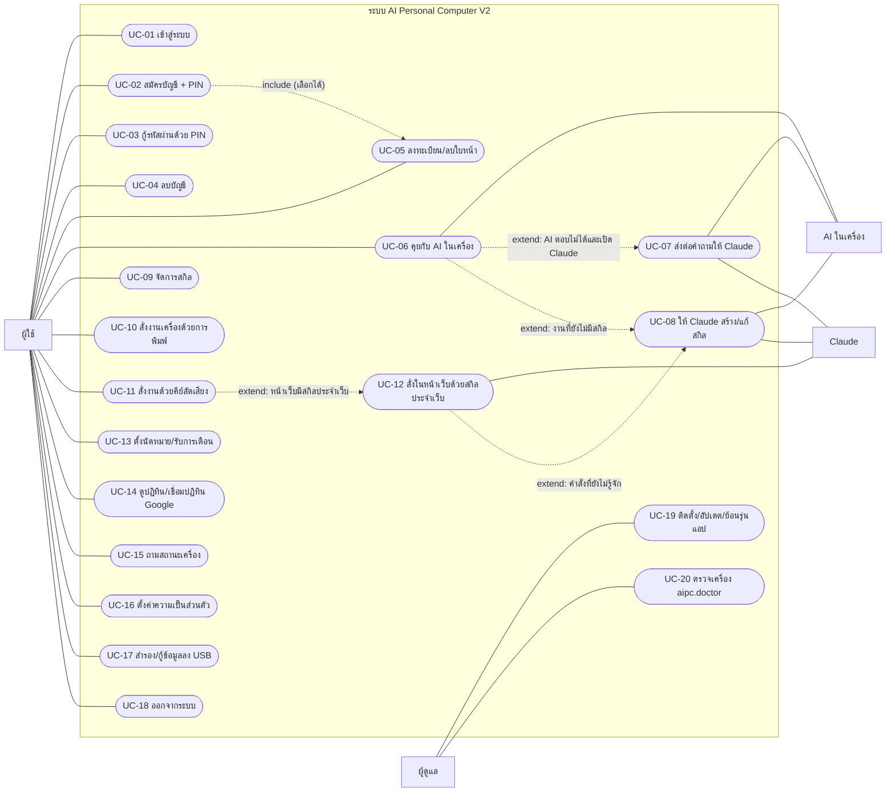
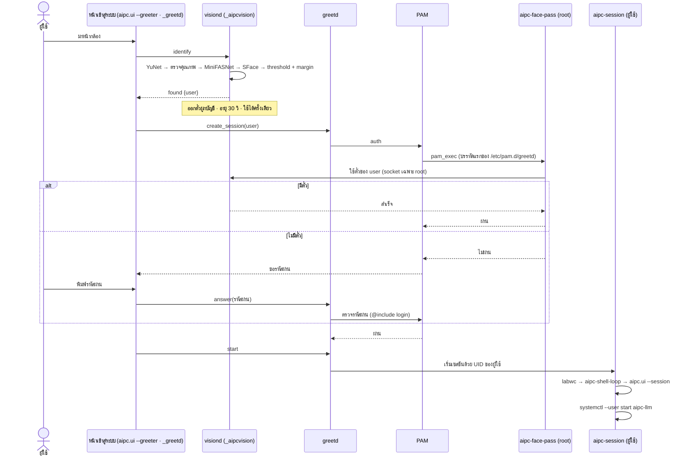
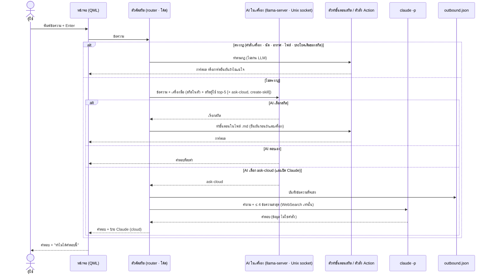
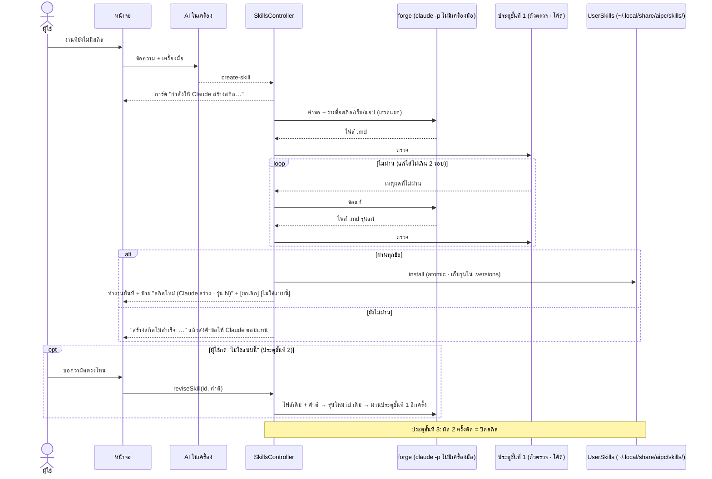
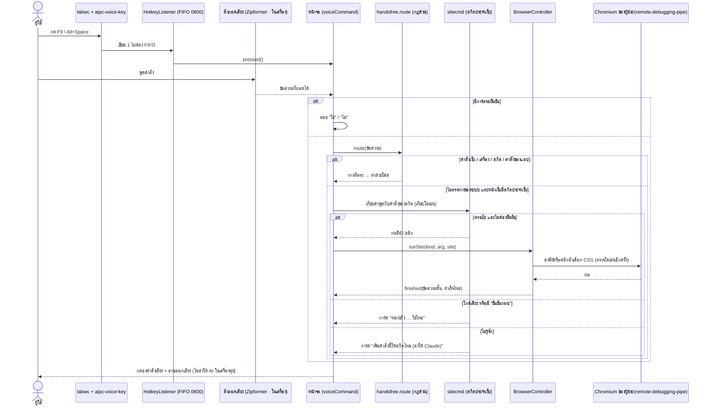
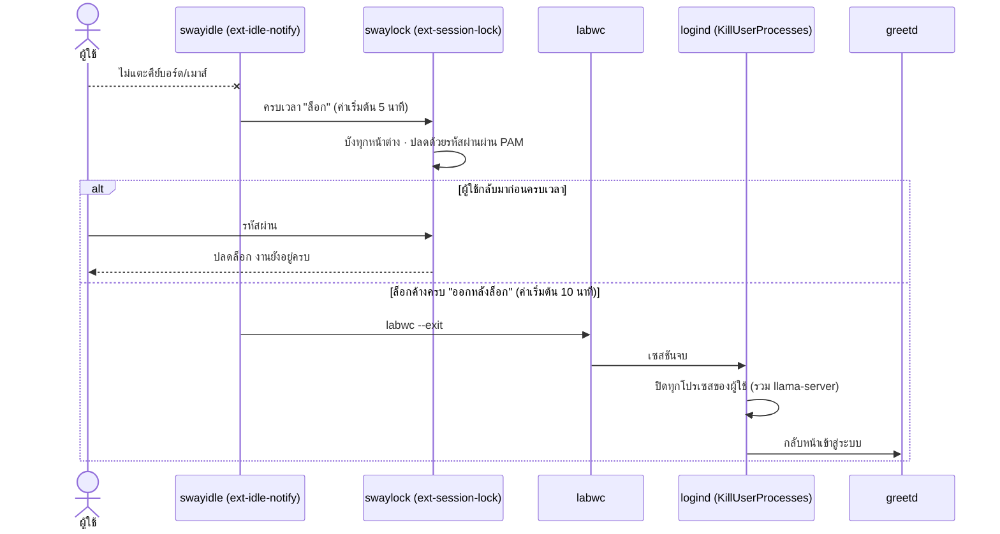
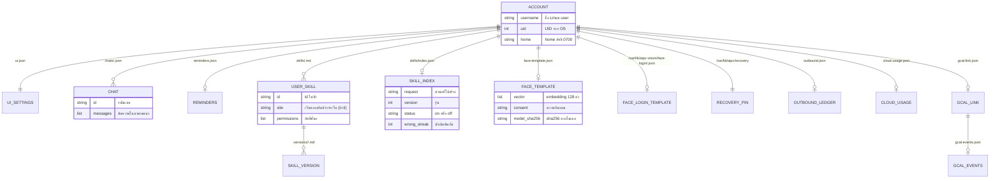

# บทที่ 4 การวิเคราะห์และออกแบบระบบ

<!-- ร่างโดยผู้ช่วย 2026-10-21 ตาม docs/thesis/draft/_rules.md · Pakon ตรวจและแก้ภาษาเอง · ทุกข้อเท็จจริงมีที่มาในคอมเมนต์ -->

บทนี้อธิบายว่าระบบ AI Personal Computer V2 ต้องทำอะไร (ความต้องการ) ใช้หลักใดตัดสินใจเมื่อความต้องการขัดกัน (การวิเคราะห์) ผู้ใช้ใช้งานระบบอย่างไร (ซีนาริโอ ยูสเคส และยูสเคสนาราทิฟ) ส่วนประกอบภายในทำงานต่อกันตามลำดับใด (ซีเควนซ์ไดอะแกรม) ข้อมูลถูกเก็บที่ใดและใครเข้าถึงได้ (การออกแบบข้อมูล) และระบบป้องกันภัยใดบ้าง (ความปลอดภัย) เนื้อหาทั้งหมดอ้างอิงจากเอกสารออกแบบของโครงงาน ได้แก่ เอกสารความต้องการ `docs/BRIEF.md` เอกสารหลักการ `docs/DESIGN.md` เอกสารสถาปัตยกรรม `docs/ARCHITECTURE.md` แบบจำลองภัย `docs/THREAT_MODEL.md` และการ์ดออกแบบรายฟีเจอร์ใน `docs/design/`

## 4.1 ความต้องการของระบบ

เอกสารความต้องการของโครงงาน (`docs/BRIEF.md`) เขียนขึ้นสำหรับ "ระบบเต็ม" 9 หมวด ต่อมาได้ตัดขอบเขตให้เหลือส่วนที่ยืนยันบน Raspberry Pi 5 ได้ทันเวลา (ข้อเสนอรอบ 3 อนุมัติวันที่ 28 กันยายน 2026) และเพิ่มบางส่วนกลับเข้ามาภายหลังตามความต้องการของอาจารย์ที่ปรึกษาและการตัดสินใจของผู้พัฒนา เช่น ระบบไฮบริดกับ Claude การสร้างสกิลโดย Claude การสแกนใบหน้าที่หน้าเข้าสู่ระบบ และการสั่งงานด้วยเสียง หัวข้อนี้จึงแสดงความต้องการพร้อมสถานะในรุ่นที่ส่ง เพื่อให้ตรวจย้อนได้ว่าข้อใดทำแล้ว ทำบางส่วน หรือย้ายไปเป็นงานต่อยอด <!-- ที่มา: docs/BRIEF.md (หมายเหตุขอบเขตรุ่นที่ส่ง) · docs/reviews/2026-09-28-scope-cut.md หัวข้อ 4–5 · docs/thesis/facts-ch1.md หัวข้อ 1.3 "ขอบเขตที่เปลี่ยนระหว่างทาง" -->

### 4.1.1 ความต้องการเชิงหน้าที่ (Functional Requirements)

ความต้องการเชิงหน้าที่ คือสิ่งที่ระบบต้องทำได้ จัดกลุ่มตามหมวดของเอกสารความต้องการ คอลัมน์ "อ้างอิง" ระบุหัวข้อในเอกสารความต้องการหรือการ์ดออกแบบที่กำหนดข้อนั้น

ตารางที่ 4.1 ความต้องการเชิงหน้าที่และสถานะในรุ่นที่ส่ง

| รหัส | ความต้องการ | อ้างอิง | สถานะในรุ่นนี้ |
|---|---|---|---|
| FR-01 | เปิดเครื่องแล้วเข้าหน้าเข้าสู่ระบบของระบบเอง โดยไม่เห็นเดสก์ท็อปของ Raspberry Pi OS | BRIEF 5.1 ข้อ 1 · การ์ด 0003 0004 | ทำ |
| FR-02 | เข้าสู่ระบบด้วยรหัสผ่านที่ระบบปฏิบัติการตรวจผ่าน PAM โดยโค้ดของโครงงานไม่ตรวจรหัสผ่านเอง | BRIEF 5.1 · การ์ด 0003 | ทำ |
| FR-03 | สมัครบัญชีจากหน้าเข้าสู่ระบบ พร้อมตั้ง PIN กู้คืน | BRIEF 5.1 ข้อ 3–4 · การ์ด 0012 | ทำ แบบสมัครเสรี ไม่มีผู้ดูแลอนุมัติ และใช้ PIN ที่ผู้ใช้ตั้งเองแทนรหัสสุ่ม |
| FR-04 | กู้รหัสผ่านด้วย PIN และลบบัญชีที่หน้าเข้าสู่ระบบ | การ์ด 0012 | ทำ |
| FR-05 | ลงทะเบียนใบหน้าแบบสมัครใจ ขอความยินยอม ลบได้ และรหัสผ่านใช้ได้เสมอ | BRIEF 5.1 ข้อ 5 และ 8 · การ์ด 0006 0010 | ทำ |
| FR-06 | สแกนใบหน้าเพื่อระบุบัญชีที่หน้าเข้าสู่ระบบ | BRIEF 5.1 ข้อ 7 · การ์ด 0015 | ทำ โดยเจ้าของบัญชีเลือกเปิดเอง และสแกนผ่านแล้วเข้าได้ทันที |
| FR-07 | หนึ่งบัญชีเท่ากับหนึ่ง Linux user มี home ของตนเอง สิทธิ์ 0700 และผู้ใช้ทั่วไปไม่มี sudo | BRIEF 5.2 ข้อ 1 | ทำ |
| FR-08 | ออกจากระบบแล้วปิดโปรเซสทั้งหมดของผู้ใช้ | BRIEF 5.2 ข้อ 6 | ทำ ด้วย `KillUserProcesses=yes` |
| FR-09 | ล็อกจอเมื่อไม่ได้ใช้งาน และออกจากระบบเองเมื่อล็อกค้างเกินเวลา | BRIEF 5.3 · การ์ด 0020 | ทำบางส่วน: ล็อกและออกเอง กล้องตรวจว่าเจ้าของยังอยู่ (เปิดเอง) แต่ไม่มี "ปิดบัง" ที่ปลดด้วยใบหน้า |
| FR-10 | แชทกับ AI ในเครื่องที่ใช้ได้ขณะออฟไลน์ คำตอบขึ้นทีละคำ หยุดได้ บันทึก เปิดต่อ แชทชั่วคราว และลบได้ | BRIEF 5.4 ข้อ 1 6 7 · การ์ด 0013 | ทำ |
| FR-11 | ป้ายบอกสถานะโมเดลจากค่าจริง และบอกตามจริงเมื่อ AI ไม่พร้อม | BRIEF 5.4 ข้อ 3 · การ์ด 0013 | ทำ |
| FR-12 | ส่งต่อคำถามที่ต้องใช้ข้อมูลสดหรือเกินความสามารถไปยัง Claude และบอกที่มาของคำตอบ | การ์ด 0016 0022 | ทำ แบบอัตโนมัติและปิดได้ (ต่างจาก BRIEF 5.4 ข้อ 4 ที่ให้ยืนยันก่อนส่งทุกครั้ง) |
| FR-13 | บันทึกทุกสิ่งที่ส่งออกนอกเครื่อง และให้ผู้ใช้ดูหรือล้างได้ | BRIEF 5.8 Privacy Center ข้อ 5 · การ์ด 0016 | ทำบางส่วน: บันทึกส่งออกและเพดานเงินต่อวัน ไม่มีหน้าความเป็นส่วนตัวแยก |
| FR-14 | สกิลเป็นไฟล์ข้อมูลที่ไม่มีโค้ดรันเอง และ AI เลือกสกิลเอง | BRIEF 5.8 Skill ข้อ 1–2 · ADR-011 | ทำ |
| FR-15 | Claude สร้างสกิลใหม่ให้ AI ในเครื่องใช้ โดยผ่านประตูตรวจก่อนติดตั้ง | การ์ด 0017 0043 | ทำ (ติดตั้งอัตโนมัติเมื่อผ่านตัวตรวจทุกชั้น ต่างจาก BRIEF 5.8 ข้อ 4 เดิม) |
| FR-16 | สั่งงานเครื่องจากรายการ Action ที่อนุญาต ไม่ผ่าน shell และถามยืนยันเมื่อไม่แน่ใจ | BRIEF 5.6 ข้อ 2–5 · การ์ด 0008 | ทำ |
| FR-17 | แยก "คุยกับ AI" ออกจาก "สั่งงานเครื่อง" ด้วยคีย์ลัดคนละช่องทาง | BRIEF 5.6 ข้อ 1 · การ์ด 0027 | ทำ คีย์ลัดเสียง F9 หรือ Alt+Space ใช้สั่งงานอย่างเดียว |
| FR-18 | สั่งงานในหน้าเว็บด้วยเสียงผ่านสกิลประจำเว็บ | การ์ด 0046 | ทำ (ยืนยันบน Pi 5 กับ YouTube) |
| FR-19 | ตั้งนัดหมายและนัดซ้ำ เตือนบนจอ และแจ้งนัดที่พลาด | การ์ด 0001 | ทำ |
| FR-20 | ดูปฏิทินรายเดือน และอ่านปฏิทิน Google แบบอ่านอย่างเดียว | การ์ด 0014 0032 0038 | ทำ (ส่วนปฏิทิน Google ยังไม่ได้ทดสอบกับปฏิทินจริงบน Pi 5 ตามเกณฑ์ของการ์ด) |
| FR-21 | ถามสถานะเครื่องเป็นภาษาคน และมีหน้าสุขภาพเครื่อง | BRIEF 5.7 ข้อ 2 · การ์ด 0009 | ทำ |
| FR-22 | อ่านออกเสียงภาษาไทย และกดพูดแล้วถอดเสียงในเครื่อง | BRIEF 5.5 · การ์ด 0019 | ทำ |
| FR-23 | ค้นไฟล์ด้วยเนื้อหา ถามเกี่ยวกับไฟล์ และสำรองข้อมูลลงไดรฟ์ USB | BRIEF 1 · 5.4 ควรมี | ทำ |
| FR-24 | เข้ารหัสข้อมูลรายบัญชี โหมดเครื่อง บัญชี Guest และขั้นตอนตั้งค่าครั้งแรก | BRIEF 5.1 5.2 | ไม่ทำ (งานต่อยอด) |
| FR-25 | ฐานข้อมูล PostgreSQL พร้อม Row Level Security | BRIEF 5.9 ข้อ 1–3 · ADR-004 | ไม่ทำ (ใช้ไฟล์ใน home แทน) |

<!-- ที่มา: docs/BRIEF.md หัวข้อ 5 · docs/reviews/2026-09-28-scope-cut.md หัวข้อ 4–5 · docs/thesis/facts-ch1.md หัวข้อ 1.3 · docs/ARCHITECTURE.md ตาราง "อะไรจริง อะไรยังไม่มี" · docs/STATUS.md (สรุป 2026-10-13/14, 2026-10-15, 2026-10-21) · docs/THREAT_MODEL.md (ความเสี่ยงที่ยอมรับ) · หมายเหตุ: facts-ch1 เขียนว่าการ์ด 0014 "ไม่ได้สร้าง" แต่ STATUS 2026-10-15 บันทึกว่าสร้างแล้วระดับ 3 และ src/aipc/skills/gcal.py มีอยู่จริง → ใช้ STATUS -->

### 4.1.2 ความต้องการที่ไม่ใช่เชิงหน้าที่ (Non-functional Requirements)

ความต้องการที่ไม่ใช่เชิงหน้าที่ คือคุณสมบัติที่ระบบต้องมีโดยไม่ขึ้นกับฟีเจอร์ใดฟีเจอร์หนึ่ง เช่น ความเป็นส่วนตัว ความทนทาน และการใช้ทรัพยากร ตัวเลขเป้าหมายในตารางเป็นเกณฑ์ที่ประกาศไว้ก่อนวัด ผลการวัดจริงอยู่ในบทที่ 5

ตารางที่ 4.2 ความต้องการที่ไม่ใช่เชิงหน้าที่

| รหัส | ด้าน | ความต้องการ | อ้างอิง |
|---|---|---|---|
| NFR-01 | ทำงานในเครื่อง | งานพื้นฐานใช้ได้โดยไม่มีอินเทอร์เน็ต ได้แก่ เข้าสู่ระบบ ล็อกและปลดล็อก แชทกับโมเดลในเครื่อง ไฟล์ของฉัน การพูด ถอดเสียง และอ่านออกเสียง คำสั่งระบบที่ไม่ใช้เน็ต การตั้งค่า สุขภาพเครื่อง และการสำรองลง USB | BRIEF 1 |
| NFR-02 | ความเป็นส่วนตัว | ข้อมูลออกนอกเครื่องได้เฉพาะทางที่ประกาศ บันทึกทุกครั้ง และปิดได้ · ไม่ส่งไฟล์ นัด ใบหน้า หรือชื่อบัญชีไปยัง Claude · ไม่เก็บภาพจากกล้องหรือเสียงดิบ | BRIEF 1 หลักการข้อ 3 · การ์ด 0016 · THREAT_MODEL |
| NFR-03 | การแยกผู้ใช้ | ผู้ใช้คนหนึ่งอ่านแชท แม่แบบใบหน้า หรือ socket ของ AI ของผู้ใช้อื่นไม่ได้ และหลังออกจากระบบไม่เหลือโปรเซสของผู้ใช้ | BRIEF 5.2 · ข้อเสนอรอบ 3 ข้ออ้าง 2 |
| NFR-04 | ความทนทานของข้อมูล | เขียนไฟล์แบบ atomic (ไฟล์ชั่วคราว → fsync → rename) · ไฟดับแล้วได้ไฟล์เดิมหรือไฟล์ใหม่ครบ ไม่มีครึ่ง ๆ · บันทึกไม่สำเร็จต้องบอกผู้ใช้ | BRIEF 5.9 ข้อ 9 · H1 H2 |
| NFR-05 | ทรัพยากร | ใช้ AI หนึ่งโมเดลต่อเซสชัน · RAM สูงสุดของโมเดลไม่เกิน 3.5 GB ที่ context 4096 token · ไม่เพิ่มบริการที่รันตลอดเวลานอกจาก LLM | ข้อเสนอรอบ 3 หัวข้อ 1 และ 7.3 · H4 |
| NFR-06 | ความเร็วของ AI | เวลาถึงคำแรกสำหรับ prompt 200 token ไม่เกิน 10 วินาที (ชั้น 3–4B) หรือ 5 วินาที (ชั้นเร็ว) · สร้างข้อความไม่ต่ำกว่า 4 token ต่อวินาที | BRIEF 5.4 · ข้อเสนอรอบ 3 หัวข้อ 7.3 |
| NFR-07 | ความเร็วของระบบ | เปิดเครื่องถึงหน้าเข้าสู่ระบบไม่เกิน 45 วินาที (เป้าเริ่มต้น) · หน้าจอลื่นไม่ต่ำกว่า 50 เฟรมต่อวินาทีขณะ LLM ตอบ | BRIEF 5.7 เกณฑ์ผ่าน |
| NFR-08 | การใช้งาน | ภาษาไทยเป็นหลัก ฟอนต์ไทยที่อ่านชัด ขนาดตัวอักษร 100–200% ธีมสว่างและมืด ข้อความผิดพลาดเป็นภาษาคนพร้อมทางแก้ | BRIEF 5.7 |
| NFR-09 | ความพร้อมใช้ | AI ในเครื่องเป็น user service ที่เริ่มใหม่เองเมื่อพัง · หน้าจอพังแล้วเปิดใหม่ พัง 3 ครั้งใน 60 วินาทีจึงจบเซสชัน · หน้าเข้าสู่ระบบต้องไม่หายหลังอัปเดต | BRIEF 5.9 ข้อ 7 และ 10 · ARCHITECTURE · ADR-009 |
| NFR-10 | ความปลอดภัยของคำสั่ง | ข้อความจาก AI ไฟล์ เว็บ หรือไฟล์สกิล กลายเป็นคำสั่ง shell ไม่ได้ · Action อยู่ใน allow-list · ไม่มีความลับใน log | BRIEF 5.6 ข้อ 5 · 5.8 Privacy Center ข้อ 4 · H8 |
| NFR-11 | การวัดผลได้ | ทุกฟีเจอร์มีเกณฑ์ผ่านที่ประกาศก่อนสร้าง และตัวเลขประสิทธิภาพมาจาก Pi 5 เท่านั้น | H9 · BRIEF 9 |
| NFR-12 | ไลเซนส์ | ใช้ในงานศึกษาเท่านั้น และประกาศไลเซนส์ของทุกส่วนประกอบรวมถึงน้ำหนักโมเดล | BRIEF 2 · ADR-014 |

<!-- ที่มา: docs/BRIEF.md หัวข้อ 1, 2, 5.2, 5.4, 5.6, 5.7, 5.8, 5.9, 9 · docs/reviews/2026-09-28-scope-cut.md หัวข้อ 1, 2, 7.3 · docs/DESIGN.md หัวข้อ 1 · docs/ARCHITECTURE.md -->

## 4.2 การวิเคราะห์

### 4.2.1 หลักการตัดสินใจ H1–H9

ความต้องการหลายข้อขัดกันเอง เช่น ความเร็วกับความทนทานของข้อมูล หรือความสะดวกกับความเป็นส่วนตัว โครงงานจึงกำหนดหลักการตัดสินใจ 9 ข้อ เมื่อหลักการขัดกัน ข้อที่เลขน้อยกว่าชนะ ข้อ H1–H4 มาจากเป้าหมายในเอกสารความต้องการโดยตรง ส่วนข้อ H5–H9 เป็นหลักวิศวกรรมที่ทำให้ข้อ H1–H4 เป็นจริงได้ <!-- ที่มา: docs/DESIGN.md หัวข้อ 1 -->

ตารางที่ 4.3 หลักการตัดสินใจและตัวอย่างการนำไปใช้ในระบบ

| หลักการ | ความหมาย | ตัวอย่างในระบบ |
|---|---|---|
| H1 ความปลอดภัยและความทนทานของข้อมูลมาก่อนความเร็ว | เขียนไฟล์แบบ atomic ไม่ปิด fsync ไม่ทำขั้นตอนเสี่ยงทำเครื่องพัง | เขียนไฟล์ชั่วคราว → fsync → rename ทุกที่ (ฟังก์ชันกลาง `fsutil.write_json`) · นัดและแม่แบบใบหน้ามีไฟล์ `.bak` |
| H2 ไม่ทำงานของผู้ใช้หายโดยไม่แจ้ง | สิ่งที่หายหรือทำไม่ทันต้องบอกผู้ใช้ | แจ้งนัดที่พลาดตอนเข้าใช้ · จอล็อกบอกว่าจะออกจากระบบเองเมื่อใด |
| H3 ความเป็นส่วนตัวเป็นค่าเริ่มต้น | ไม่เก็บภาพหรือเสียงดิบ ไม่ส่งข้อมูลส่วนตัวออก | ตัวตรวจด้วยกล้องไม่บันทึกภาพ · รอบที่ถามเกี่ยวกับไฟล์ไม่ส่งต่อ Claude |
| H4 local-first และพอดีกับ Pi 5 8GB | งานพื้นฐานใช้ได้ออฟไลน์ เลือกทางที่ใช้ทรัพยากรน้อยกว่า | AI หนึ่งโมเดล · เลือกสกิลและค้นไฟล์ด้วย TF-IDF ไม่ใช้โมเดลเพิ่ม · กล้องเปิดเฉพาะตอนไม่มีการแตะเครื่อง |
| H5 ความจริงก่อนความสวย | ห้ามแสดงผลจำลองให้ดูเหมือนสำเร็จ | ช่อง "ทำไมได้คำตอบนี้" สร้างจากสิ่งที่เกิดจริง · ป้าย "Claude (cloud)" · โหมดพัฒนามีแถบเตือนสีส้มตลอด |
| H6 งานที่ต้องถูกแน่นอนให้โค้ดทำ งานภาษาให้ LLM ทำ | วันเวลา การนับ การสั่งเครื่อง การตัดสินสิทธิ์ = โค้ด | แปลงวันเวลาของนัดด้วยโค้ด · คีย์ลัดเสียงใช้ตัวแปลแบบกฎล้วน · ขั้นตอนของสกิลโค้ดเป็นผู้ทำ |
| H7 backend ตัดสินสิทธิ์ ไม่ใช่หน้าจอ | หน้าจอตรวจเพื่อแจ้งผู้ใช้เร็ว ๆ เท่านั้น | ตัวช่วยสิทธิ์ root ตรวจกฎการสมัครซ้ำ · คำสั่งที่รอยืนยันเก็บฝั่ง Python หน้าจอส่งกลับได้แค่ token |
| H8 ข้อมูลไม่ใช่คำสั่ง | เนื้อหาไฟล์ ผลของ LLM และไฟล์สกิลห้ามกลายเป็นคำสั่ง shell หรือ URL ที่ประกอบเอง | คำตอบของ Claude แสดงเป็นข้อความ · สกิลไม่มีโค้ด · Action อยู่ใน allow-list |
| H9 วัดผลได้และตั้งเกณฑ์ก่อนสร้าง | การ์ดออกแบบต้องมีเกณฑ์ผ่านก่อนเขียนโค้ด | ผลวัดทุกชุดใน `docs/benchmarks/` ประกาศเกณฑ์ก่อน และรายงานรอบที่ไม่ผ่านด้วย |

<!-- ที่มา: docs/DESIGN.md หัวข้อ 1 · docs/thesis/facts-ch3.md หัวข้อ 3.2 · src/aipc/fsutil.py · docs/design/0027-voice-command-mode.md หัวข้อ 2 -->

ตัวอย่างการใช้หลักการลำดับก่อนหลัง ได้แก่ การสแกนใบหน้าเพื่อดูว่าเจ้าของเครื่องยังอยู่ (การ์ด 0020) ซึ่งผลทดลองขั้น B พบว่ากรณีหนึ่งไม่ผ่านเกณฑ์ ระบบจึงใช้ผลจากกล้องเพื่อ "ล็อก" เท่านั้นเมื่อเห็นคนอื่น แต่ไม่ "ออกจากระบบ" จากการจำหน้า เพราะการออกจากระบบทำให้งานที่ยังไม่บันทึกหาย (H2 ชนะความสะดวก) และเป็นไปตามกฎที่ประกาศไว้ก่อนวัด (H9) <!-- ที่มา: docs/ARCHITECTURE.md หัวข้อ "ล็อกเมื่อไม่ได้ใช้" · docs/thesis/facts-ch3.md หัวข้อ 3.5.7 · docs/benchmarks/2026-10-06-presence-b/README.md -->

### 4.2.2 ชั้นของระบบ

เอกสารหลักการแบ่งระบบเป้าหมายเป็น 5 ชั้น ตั้งแต่ฮาร์ดแวร์ถึงหน้าจอ แต่รุ่นที่ส่งสร้างจริงเพียงบางส่วนตามขอบเขตรอบ 3 ตารางต่อไปนี้เทียบชั้นตามแบบกับสิ่งที่มีในรุ่นนี้

ตารางที่ 4.4 ชั้นของระบบตามแบบเทียบกับรุ่นที่ส่ง

| ชั้น | ตามแบบ (DESIGN) | ในรุ่นที่ส่ง |
|---|---|---|
| 4 หน้าจอ | QML วาดอย่างเดียว ไม่ตัดสินอะไร | QML (`src/aipc/ui/qml/AipcUi/`) วาดอย่างเดียว · การตัดสินใจอยู่ใน Python ที่มีเทสต์ |
| 3 Session Agent ต่อผู้ใช้ | ตัวคัดสกิล ข้อมูลส่วนตัว และตัวสั่ง Action แยกโปรเซสจากหน้าจอ | ชิ้นส่วนเหล่านี้มีครบ แต่รันในโปรเซสเดียวกับหน้าจอ ด้วย UID ของผู้ใช้คนนั้น · ตรรกะเขียนเป็น Python ที่ไม่พึ่ง Qt เพื่อย้ายแยกโปรเซสได้ภายหลัง |
| 2 บริการของระบบ | authd · visiond · resourced · ai-workers | AI ในเครื่องเป็น llama-server ของผู้ใช้แต่ละคน (user service ต่อเน็ตไม่ได้) · visiond มีเฉพาะที่หน้าเข้าสู่ระบบ (ผู้ใช้ระบบ `_aipcvision`) · งานบัญชีใช้ตัวช่วย root ตัวเดียว (`aipc-accounts`) · ไม่มี authd และ resourced |
| 1 ระบบปฏิบัติการ | Linux user ต่อบัญชี · home 0700 + fscrypt · systemd · PipeWire | Linux user ต่อบัญชี · home 0700 · systemd · PipeWire · ไม่มีการเข้ารหัส home (ADR-003) |
| 0 ฮาร์ดแวร์ | Pi 5 8GB · อะแดปเตอร์ 27W · Active Cooler · RTC · กล้อง ไมค์ ลำโพง | ตามแบบ · กล้องเป็น USB ไม่ใช่กล้อง CSI ที่ยึดในเคส |

<!-- ที่มา: docs/DESIGN.md หัวข้อ 2 และ "ขอบเขตรอบ 3" · docs/ARCHITECTURE.md · docs/design/0015-face-login.md · docs/thesis/facts-ch1.md หัวข้อ 1.3 ฮาร์ดแวร์ · หมายเหตุ: DESIGN หัวข้อ 2 เขียนว่า "ชั้น 2 ยังไม่มีเลย" ซึ่งเก่ากว่าการ์ด 0015 -->

ภาพรวมการทำงานตั้งแต่เปิดเครื่องถึงออกจากระบบ เป็นดังนี้ systemd เปิด greetd ซึ่งเปิดหน้าเข้าสู่ระบบของโครงงานในนามผู้ใช้ระบบ `_greetd` เมื่อ PAM ตรวจผ่าน (ด้วยรหัสผ่าน หรือตั๋วจาก visiond เมื่อสแกนหน้าผ่าน) ระบบเริ่มเซสชันในนามผู้ใช้คนนั้น เปิด labwc และหน้าจอเซสชันแบบเต็มจอ พร้อมเริ่ม llama-server ของผู้ใช้ ระหว่างเซสชันมีตัวจับเวลาการไม่ใช้งาน (swayidle) ตัวล็อกจอ (swaylock) และเรียกโปรแกรมอื่นตามคำขอ ได้แก่ `claude -p` Piper whisper.cpp และ Open-Meteo เมื่อผู้ใช้กด "ออก" labwc ปิดตัว และ `KillUserProcesses` ปิดทุกโปรเซสของผู้ใช้ก่อนกลับหน้าเข้าสู่ระบบ <!-- ที่มา: docs/thesis/facts-ch3.md หัวข้อ 3.1 · docs/ARCHITECTURE.md -->

[ภาพที่ 4.1 สถาปัตยกรรมของระบบตั้งแต่เปิดเครื่องถึงออกจากระบบ — ต้องเติม: วาดแผนภาพจากแผนผังข้อความใน docs/thesis/facts-ch3.md หัวข้อ 3.1]

### 4.2.3 ความเป็นเจ้าของข้อมูล

หลักของการออกแบบข้อมูลคือ ข้อมูลของผู้ใช้อยู่ใน home ของผู้ใช้คนนั้น ซึ่งระบบปฏิบัติการกันผู้ใช้อื่นไว้ให้ด้วยสิทธิ์ 0700 ข้อมูลของระบบที่ต้องอ่านได้ก่อนมีใครเข้าสู่ระบบ (PIN กู้คืน และแม่แบบใบหน้าสำหรับหน้าเข้าสู่ระบบ) อยู่นอก home และอ่านได้เฉพาะผู้ใช้ระบบที่รับผิดชอบ ส่วนรายการ Action และสิทธิ์ของสกิลเป็นของระบบ เพิ่มได้ด้วยการแก้โค้ดเท่านั้น ภาพจากกล้องและเสียงจากไมค์ไม่มีเจ้าของในรูปไฟล์ เพราะอยู่ในหน่วยความจำเท่านั้น รายละเอียดของข้อมูลแต่ละรายการอยู่ในหัวข้อ 4.7 <!-- ที่มา: docs/DESIGN.md หัวข้อ 3 · docs/thesis/facts-ch3.md หัวข้อ 3.1 "ข้อมูลอยู่ที่ไหน" -->

โครงงานเลือกไม่ใช้ฐานข้อมูล (ADR-004) เพราะระบบใช้งานครั้งละหนึ่งคนและไม่มีข้อมูลกลางที่หลายคนต้องใช้ร่วมกัน ระบบปฏิบัติการแยกข้อมูลรายบัญชีให้แล้ว และฐานข้อมูลที่รันตลอดเวลากิน RAM ที่ต้องเหลือให้ AI ในเครื่อง ทางเลือก PostgreSQL ร่วมกับ Row Level Security ได้ทดลองแล้วบน Pi 4 ผ่าน 13 จาก 13 ข้อ จึงเป็นทางเลือกที่ประเมินแล้ว ไม่ใช่ทางที่ไม่ได้พิจารณา <!-- ที่มา: docs/thesis/facts-ch3.md หัวข้อ 3.4 (ADR-004) · docs/benchmarks/2026-09-24-pi4-pg-rls.md · ผล Pi 4 -->

## 4.3 ซีนาริโอ (Scenario)

ซีนาริโอต่อไปนี้แสดงการใช้งานจริงของระบบ สร้างจากฟีเจอร์ที่มีโค้ดและติดตั้งในรุ่นที่ส่งเท่านั้น ผู้ใช้ในซีนาริโอเป็นตัวอย่างสมมติ (ผู้ใช้ ก และผู้ใช้ ข)

### 4.3.1 ซีนาริโอที่ 1 เข้าสู่ระบบด้วยใบหน้าบนเครื่องที่ใช้ร่วมกัน

ผู้ใช้ ก และผู้ใช้ ข ใช้เครื่องเดียวกัน ผู้ใช้ ก สมัครบัญชีที่หน้าเข้าสู่ระบบ ตั้งรหัสผ่านและ PIN กู้คืน ลงทะเบียนใบหน้า และเลือกเปิดการสแกนหน้าเข้าเครื่อง เมื่อเปิดเครื่อง หน้าเข้าสู่ระบบขอให้ visiond สแกน พบผู้ใช้ ก ระบบเข้าสู่ระบบในนามผู้ใช้ ก โดยแสดงว่า "เข้าด้วยใบหน้า" พร้อมปุ่ม "ไม่ใช่ฉัน" ต่อมาผู้ใช้ ก ลุกไปโดยไม่กดออก เมื่อไม่มีการใช้งานครบ 5 นาที จอถูกล็อก และเมื่อล็อกค้างครบ 10 นาที ระบบออกจากระบบให้เอง ผู้ใช้ ข จึงเข้าบัญชีของตนได้โดยไม่เห็นงานของผู้ใช้ ก ส่วนผู้ใช้ ข ที่ไม่ได้เปิดการสแกนหน้า ใช้รหัสผ่านเข้าสู่ระบบตามปกติ <!-- ที่มา: docs/design/0012-real-signup.md · docs/design/0015-face-login.md หัวข้อ 12 · docs/ARCHITECTURE.md หัวข้อล็อก (ค่าเริ่มต้น 5 และ 10 นาที) · docs/thesis/facts-ch1.md หัวข้อ 1.1 (ปัญหาหลายคนใช้เครื่องเดียว) -->

### 4.3.2 ซีนาริโอที่ 2 คุยกับ AI ในเครื่องขณะไม่มีอินเทอร์เน็ต

ผู้ใช้ ก พิมพ์ขอให้ช่วยเรียบเรียงข้อความภาษาไทย ข้อความไม่ตรงกฎคำสั่งใด จึงถูกส่งให้ AI ในเครื่อง (Gemma 4 E2B บน llama-server ของผู้ใช้ ก) ผ่าน Unix socket คำตอบขึ้นทีละคำ ผู้ใช้กด Esc เพื่อหยุดได้ แชทถูกบันทึกและเปิดต่อได้ภายหลัง หรือเลือกเป็นแชทชั่วคราวที่ไม่เขียนลงดิสก์ ใต้คำตอบมีช่อง "ทำไมได้คำตอบนี้" ซึ่งบอกว่าตอบโดย AI ในเครื่อง และไม่มีข้อมูลออกนอกเครื่อง แม้เครื่องถูกถอดสายเครือข่าย ฟีเจอร์นี้ยังทำงาน เพราะ llama-server ไม่ต้องใช้เน็ต และถูกระบบปฏิบัติการห้ามต่อเน็ตอยู่แล้ว <!-- ที่มา: docs/design/0013-local-chat.md · docs/ARCHITECTURE.md หัวข้อ "AI ในเครื่อง" และ "เส้นทางของข้อความ" · docs/thesis/facts-ch3.md หัวข้อ 3.5.3 -->

### 4.3.3 ซีนาริโอที่ 3 ส่งต่อคำถามที่ต้องใช้ข้อมูลสดให้ Claude

ผู้ใช้ ก ซึ่งเข้าสู่ระบบ Claude Code ในบัญชีของตนแล้ว และเปิดสวิตช์ Claude ไว้ ถามเรื่องที่ต้องใช้ข้อมูลล่าสุด AI ในเครื่องไม่มีข้อมูลสด จึงเลือกเครื่องมือ ask-cloud ระบบเรียก `claude -p` ที่ค้นเว็บได้อย่างเดียว ส่งคำถามพร้อมบริบทไม่เกิน 4 ข้อความล่าสุด คำตอบแสดงพร้อมป้ายว่าตอบโดย Claude (cloud) ช่อง "ทำไมได้คำตอบนี้" ระบุว่าข้อมูลออกนอกเครื่อง และข้อความที่ส่งออกถูกบันทึกตามตัวอักษรใน `outbound.json` ซึ่งผู้ใช้เปิดดูหรือล้างได้ในหน้าตั้งค่า หากถึงเพดานเงินต่อวัน หรือไม่มีเน็ต ระบบบอกตรง ๆ และ AI ในเครื่องยังใช้งานได้ <!-- ที่มา: docs/design/0016-hybrid-cloud.md หัวข้อ 1 · docs/thesis/facts-ch3.md หัวข้อ 3.5.6 · docs/ARCHITECTURE.md หัวข้อ "ไฮบริด" -->

### 4.3.4 ซีนาริโอที่ 4 ให้ Claude สร้างสกิลใหม่

ผู้ใช้ ก พิมพ์ "เปิดโหมดทำงาน" ซึ่งเครื่องยังไม่มีสกิลรองรับ AI ในเครื่องจึงเรียกเครื่องมือ create-skill หน้าจอแสดงว่ากำลังให้ Claude สร้างสกิล Claude เขียนไฟล์สกิล `.md` โดยไม่มีเครื่องมือใด ๆ จากนั้นโค้ดตรวจไฟล์ (ประตูชั้นที่ 1) เมื่อผ่าน สกิลถูกติดตั้งในโฟลเดอร์สกิลของผู้ใช้ ก และทำงานนั้นทันที การ์ดผลลัพธ์มีป้าย "สกิลใหม่ (Claude สร้าง · รุ่น 1)" พร้อมปุ่มยกเลิกและปุ่ม "ไม่ใช่แบบนี้" เมื่อผู้ใช้สั่งแบบเดิมครั้งต่อไป AI ในเครื่องเรียกสกิลนี้เองโดยไม่ต้องใช้เน็ต ผู้ใช้ ข มองไม่เห็นสกิลนี้ เพราะอยู่ใน home ของผู้ใช้ ก <!-- ที่มา: docs/design/0017-auto-skill.md หัวข้อ 1, 4, 5, 6 (ตัวอย่าง "เปิดโหมดทำงาน" มาจากการ์ด) -->

### 4.3.5 ซีนาริโอที่ 5 สั่งงานด้วยคีย์ลัดเสียงและสกิลประจำเว็บบน YouTube

ผู้ใช้ ก กด F9 แล้วพูดว่า "เปิดยูทูบ" ระบบถอดเสียงในเครื่อง แปลเป็นคำสั่งด้วยกฎ และเปิด YouTube ในเบราว์เซอร์ของผู้ช่วย เมื่อวิดีโอเล่นอยู่ ผู้ใช้กด F9 แล้วพูดว่า "เดินหน้าสิบวิ" คำพูดนี้ตรงกับคำสั่งในสกิลประจำเว็บของ YouTube ระบบจึงกดคีย์ลัดของเว็บให้ หากได้ยินเพียงใกล้เคียง ระบบถามว่า "หมายถึง … ใช่ไหม" และหากเป็นคำที่สกิลยังไม่รู้จัก ระบบถามว่าจะให้ Claude เพิ่มคำสั่งนี้เข้าสกิลประจำเว็บของผู้ใช้หรือไม่ คำพูดผ่านคีย์ลัดไม่ถูกส่งให้ AI ในเครื่องคุย หากต้องการคุย ผู้ใช้พิมพ์หรือกดปุ่มไมค์ในหน้าแชท <!-- ที่มา: docs/design/0027-voice-command-mode.md · docs/design/0046-site-skills.md หัวข้อ 2 (ตัวอย่าง "เดินหน้าสิบวิ → กดคีย์ l") · src/aipc/ui/handsfree.py -->

### 4.3.6 ซีนาริโอที่ 6 นัดหมาย การเตือน และปฏิทิน

ผู้ใช้ ข พิมพ์ขอให้เตือนนัดในวันพรุ่งนี้ โค้ดแปลงวันเวลาและแสดงการ์ดให้ยืนยันก่อนบันทึก รวมถึงสิ่งที่ตีความเอง เช่น เวลาที่ใช้เมื่อผู้ใช้ไม่ได้บอก เมื่อถึงเวลา ระบบเตือนบนจอ และเลือกให้อ่านออกเสียงได้ หากเครื่องปิดอยู่ตอนถึงเวลา ระบบแจ้งนัดที่พลาดเมื่อผู้ใช้เข้าใช้ครั้งถัดไป ผู้ใช้ ข ยังเชื่อมปฏิทิน Google ด้วยลิงก์ iCal แบบลับ เพื่อให้นัดใน Google ปรากฏในหน้าปฏิทินรายเดือนและในคำตอบเรื่องนัด แบบอ่านอย่างเดียว ชื่อนัดจาก Google แสดงเป็นข้อความและไม่ถูกส่งให้ AI <!-- ที่มา: docs/design/0001-reminder.md · docs/design/0016-hybrid-cloud.md บรรทัด assumptions · docs/ARCHITECTURE.md ตาราง "นัดหมาย" · docs/design/0014-calendar.md · docs/design/0038-calendar-page.md · docs/THREAT_MODEL.md (ลิงก์ลับของปฏิทิน Google) -->

### 4.3.7 ซีนาริโอที่ 7 ถามสุขภาพเครื่อง

ผู้ใช้ ก รู้สึกว่าเครื่องช้า จึงพิมพ์ถามว่าเครื่องเป็นอะไร โค้ดอ่านค่าจริงจาก `aipc.doctor` อุณหภูมิ CPU และหน่วยความจำว่าง ตัดสินว่ามีปัญหาใด เช่น ร้อนเกิน ไฟไม่พอ RAM หรือพื้นที่ใกล้เต็ม แล้วตอบเป็นภาษาคนพร้อมวิธีแก้ ค่าที่อ่านไม่ได้ระบบตอบว่า "ไม่รู้" แทนการเดา ผู้ใช้เปิดหน้าสุขภาพเครื่องเพื่อดูค่าเดียวกันซึ่งปรับทุก 10 วินาที และถามด้วยคีย์ลัดเสียงแล้วฟังคำตอบที่อ่านออกเสียงได้ <!-- ที่มา: docs/design/0009-skill-machine.md · docs/ARCHITECTURE.md ตาราง "แถบสถานะ หน้าสุขภาพเครื่อง" · docs/design/0029-voice-answers.md (สถานะใน STATUS สรุป 2026-10-13/14) -->

## 4.4 ยูสเคส (Use Case)

### 4.4.1 ผู้กระทำและยูสเคสของระบบ

ระบบมีผู้กระทำ (actor) 4 ราย ได้แก่ ผู้ใช้ ผู้ดูแล AI ในเครื่อง และ Claude โดย AI ในเครื่องและ Claude เป็นผู้กระทำที่เป็นระบบภายนอกของส่วนควบคุม กล่าวคือ ทั้งสองเสนอคำตอบหรือไฟล์สกิลได้ แต่การกระทำต่อเครื่องทุกอย่างผ่านโค้ดที่ตรวจสิทธิ์ (H7 H8)

ตารางที่ 4.5 ผู้กระทำของระบบ

| ผู้กระทำ | ความหมายในรุ่นนี้ |
|---|---|
| ผู้ใช้ | เจ้าของบัญชีหนึ่งบัญชี (หนึ่ง Linux user) ที่สมัครเองที่หน้าเข้าสู่ระบบ ไม่มีสิทธิ์ sudo |
| ผู้ดูแล | บัญชีแรกจากตอนติดตั้งระบบปฏิบัติการ ทำงานติดตั้ง อัปเดต ย้อนรุ่น และตรวจเครื่องผ่านสคริปต์ใน `scripts/pi/` และ `aipc.doctor` |
| AI ในเครื่อง | llama-server ของผู้ใช้คนนั้นกับโมเดล Gemma 4 E2B ตอบข้อความ เลือกสกิล และเลือกเครื่องมือ ask-cloud หรือ create-skill |
| Claude | Claude Code ที่ผู้ใช้แต่ละคนติดตั้งและเข้าสู่ระบบเอง เรียกผ่าน `claude -p` เพื่อตอบคำถามที่ส่งต่อ หรือเขียนไฟล์สกิล |

<!-- ที่มา: docs/thesis/facts-ch1.md หัวข้อ 1.5 นิยามศัพท์ · docs/ARCHITECTURE.md หัวข้อ "ไฮบริด" · docs/thesis/facts-ch3.md หัวข้อ 3.5.10 -->

ตารางที่ 4.6 รายการยูสเคส

| รหัส | ยูสเคส | ผู้กระทำหลัก | ผู้กระทำร่วม | การ์ด |
|---|---|---|---|---|
| UC-01 | เข้าสู่ระบบ (รหัสผ่านหรือใบหน้า) | ผู้ใช้ | — | 0003 0015 |
| UC-02 | สมัครบัญชีและตั้ง PIN กู้คืน | ผู้ใช้ | — | 0012 |
| UC-03 | กู้รหัสผ่านด้วย PIN | ผู้ใช้ | — | 0012 |
| UC-04 | ลบบัญชี | ผู้ใช้ | — | 0012 |
| UC-05 | ลงทะเบียนและลบใบหน้า | ผู้ใช้ | — | 0006 0010 0015 |
| UC-06 | คุยกับ AI ในเครื่อง | ผู้ใช้ | AI ในเครื่อง | 0013 |
| UC-07 | ส่งต่อคำถามให้ Claude | ผู้ใช้ | AI ในเครื่อง · Claude | 0016 0022 |
| UC-08 | ให้ Claude สร้างหรือแก้สกิล | ผู้ใช้ | AI ในเครื่อง · Claude | 0017 0030 0046 |
| UC-09 | จัดการสกิล (ดู เปิดปิด ย้อนรุ่น ลบ ส่งออก นำเข้า) | ผู้ใช้ | — | 0017 |
| UC-10 | สั่งงานเครื่องด้วยการพิมพ์ | ผู้ใช้ | — | 0008 |
| UC-11 | สั่งงานด้วยคีย์ลัดเสียง | ผู้ใช้ | — | 0026 0027 0042 |
| UC-12 | สั่งในหน้าเว็บด้วยสกิลประจำเว็บ | ผู้ใช้ | Claude (เมื่อเพิ่มคำสั่ง) | 0046 |
| UC-13 | ตั้งนัดหมายและรับการเตือน | ผู้ใช้ | — | 0001 |
| UC-14 | ดูปฏิทินและเชื่อมปฏิทิน Google | ผู้ใช้ | — | 0014 0038 |
| UC-15 | ถามสถานะเครื่องและดูหน้าสุขภาพเครื่อง | ผู้ใช้ | — | 0009 |
| UC-16 | ตั้งค่าความเป็นส่วนตัว (สวิตช์ Claude เพดานเงิน ดูและล้างบันทึกส่งออก ล็อก กล้อง) | ผู้ใช้ | — | 0016 0020 |
| UC-17 | สำรองและกู้ข้อมูลลง USB | ผู้ใช้ | — | — |
| UC-18 | ออกจากระบบ | ผู้ใช้ | — | 0004 |
| UC-19 | ติดตั้ง อัปเดต และย้อนรุ่นแอป | ผู้ดูแล | — | ADR-009 |
| UC-20 | ตรวจเครื่องด้วย `aipc.doctor` | ผู้ดูแล | — | — |

<!-- ที่มา: docs/ARCHITECTURE.md · docs/thesis/facts-ch3.md หัวข้อ 3.5 · docs/STATUS.md · การ์ดตามคอลัมน์ "การ์ด" -->

### 4.4.2 ยูสเคสไดอะแกรม (Use Case Diagram)

[ภาพที่ 4.2 ยูสเคสไดอะแกรมของระบบ — ต้องเติม: แปลงบล็อก Mermaid ด้านล่างเป็นภาพ หรือวาดใหม่ในรูปแบบ UML]

ยูสเคส UC-07 และ UC-08 เป็นส่วนขยาย (extend) ของ UC-06 เพราะเกิดขึ้นเฉพาะเมื่อ AI ในเครื่องเลือกเครื่องมือ ask-cloud หรือ create-skill และเครื่องมือทั้งสองจะอยู่ในรายการที่ AI เห็นเฉพาะเมื่อผู้ใช้เปิด Claude ไว้ ส่วน UC-12 เป็นส่วนขยายของ UC-11 เพราะใช้เมื่อหน้าที่เปิดอยู่ในเบราว์เซอร์ของผู้ช่วยเป็นเว็บที่มีสกิลประจำเว็บเท่านั้น <!-- ที่มา: docs/ARCHITECTURE.md หัวข้อ "เส้นทางของข้อความ" และ "สกิลประจำเว็บ" · docs/design/0017-auto-skill.md หัวข้อ 8 -->

## 4.5 ยูสเคสนาราทิฟ (Use Case Narrative)

หัวข้อนี้อธิบายยูสเคสหลัก 6 รายการโดยละเอียด

ตารางที่ 4.7 ยูสเคสนาราทิฟ UC-01 เข้าสู่ระบบ

| หัวข้อ | รายละเอียด |
|---|---|
| ชื่อยูสเคส | UC-01 เข้าสู่ระบบ |
| ผู้กระทำ | ผู้ใช้ |
| เงื่อนไขก่อน | ผู้ใช้มีบัญชีแล้ว · เครื่องอยู่ที่หน้าเข้าสู่ระบบ · ถ้าจะใช้ใบหน้า เจ้าของบัญชีต้องเปิดการสแกนหน้าเข้าเครื่องไว้ |
| ขั้นตอนหลัก | 1. หน้าเข้าสู่ระบบขอให้ visiond สแกนหน้า 2. visiond พบบัญชีที่ผ่านเกณฑ์ threshold margin และการตรวจหน้าปลอม แล้วออกตั๋วผูกกับบัญชีนั้น 3. หน้าเข้าสู่ระบบสร้างเซสชันผ่าน greetd 4. PAM เรียก `aipc-face-pass` ซึ่งใช้ตั๋ว 5. ตั๋วถูกต้อง PAM ผ่าน 6. ระบบเริ่มเซสชันของผู้ใช้ เปิด labwc หน้าจอเซสชัน และ AI ในเครื่อง |
| ทางเลือก | ก. ผู้ใช้พิมพ์ชื่อและรหัสผ่านแทน PAM ตรวจรหัสผ่าน · ข. ผู้ใช้กด "ไม่ใช่ฉัน" ระบบล้างผลสแกนให้พิมพ์ชื่อเอง · ค. ลืมรหัสผ่าน ไปยัง UC-03 |
| ข้อผิดพลาด | รหัสผิด แสดงข้อความและให้ลองใหม่ · สแกนไม่ผ่าน 5 ครั้งติด ต้องใช้รหัสผ่านจนกว่าจะเข้าด้วยรหัสผ่านสำเร็จ · คะแนนใกล้อันดับสองเกินไป ตอบว่าไม่รู้จัก ไม่เดา · กล้องหลุดหรือ visiond ล่ม ใช้รหัสผ่านได้ตามปกติ · ตั๋วหมดอายุใน 30 วินาทีและใช้ได้ครั้งเดียว |
| ผลลัพธ์ | ผู้ใช้อยู่ในเซสชันของตนเองที่ทำงานด้วย UID ของตนเอง |

<!-- ที่มา: docs/design/0015-face-login.md หัวข้อ 5, 6, 12 · docs/ARCHITECTURE.md หัวข้อ "เปิดเครื่องถึงหน้าจอ V2" · docs/design/0003-real-login.md -->

ตารางที่ 4.8 ยูสเคสนาราทิฟ UC-06 คุยกับ AI ในเครื่อง

| หัวข้อ | รายละเอียด |
|---|---|
| ชื่อยูสเคส | UC-06 คุยกับ AI ในเครื่อง |
| ผู้กระทำ | ผู้ใช้ (หลัก) · AI ในเครื่อง (ร่วม) |
| เงื่อนไขก่อน | ผู้ใช้อยู่ในเซสชัน · llama-server ของผู้ใช้พร้อม (ป้ายโมเดลอ่านจาก `/health`) |
| ขั้นตอนหลัก | 1. ผู้ใช้พิมพ์ข้อความแล้วกด Enter 2. ตัวคัดสกิลตรวจกฎด้วยโค้ดก่อน 3. ไม่ตรงกฎ ส่งข้อความให้ AI ในเครื่องพร้อมรายการเครื่องมือ (สกิลในตัว สกิลของผู้ใช้ที่เกี่ยวที่สุด 5 ตัว และ ask-cloud กับ create-skill เมื่อเปิด Claude) 4. AI ตอบเอง คำตอบขึ้นทีละคำ 5. ระบบแสดง "ทำไมได้คำตอบนี้" และบันทึกแชทแบบ atomic |
| ทางเลือก | ก. ข้อความตรงกฎ ทำตามกฎโดยไม่ผ่าน AI · ข. AI เลือกสกิล โค้ดทำตามขั้นตอนในไฟล์ `.md` และแสดงการ์ดยืนยันถ้าแตะเครื่อง · ค. AI เลือก ask-cloud ไปยัง UC-07 · ง. AI เลือก create-skill ไปยัง UC-08 · จ. ผู้ใช้กด Esc เพื่อหยุดการตอบ · ฉ. แชทชั่วคราวไม่เขียนลงดิสก์ |
| ข้อผิดพลาด | AI ไม่พร้อมหรือกำลังเริ่มใหม่ บอกตามจริง · llama-server พัง systemd เริ่มใหม่เอง (`Restart=on-failure`) |
| ผลลัพธ์ | ผู้ใช้ได้คำตอบจาก AI ในเครื่อง ไม่มีข้อมูลออกนอกเครื่องในเส้นทางนี้ |

<!-- ที่มา: docs/design/0013-local-chat.md · docs/ARCHITECTURE.md หัวข้อ "AI ในเครื่อง" และ "เส้นทางของข้อความ" · docs/thesis/facts-ch3.md หัวข้อ 3.5.3–3.5.4 -->

ตารางที่ 4.9 ยูสเคสนาราทิฟ UC-07 ส่งต่อคำถามให้ Claude

| หัวข้อ | รายละเอียด |
|---|---|
| ชื่อยูสเคส | UC-07 ส่งต่อคำถามให้ Claude |
| ผู้กระทำ | ผู้ใช้ (หลัก) · AI ในเครื่อง · Claude |
| เงื่อนไขก่อน | สวิตช์ Claude เปิดอยู่ (ค่าเริ่มต้นเปิด) · ผู้ใช้เข้าสู่ระบบ Claude Code ในบัญชีของตน · ยังไม่ถึงเพดานเงินต่อวัน · ไม่ได้ตั้ง `AIPC_CLOUD=0` |
| ขั้นตอนหลัก | 1. AI ในเครื่องเลือก ask-cloud หรือตอบว่าไม่รู้ 2. ระบบเตรียมข้อความ: คำถามและไม่เกิน 4 ข้อความล่าสุด ข้อละไม่เกิน 600 ตัวอักษร ข้ามรอบที่ถามเกี่ยวกับไฟล์ 3. เรียก `claude -p` จากโฟลเดอร์ว่าง อนุญาตเฉพาะ WebSearch เพดาน 0.50 ดอลลาร์ต่อครั้ง หมดเวลา 120 วินาที 4. บันทึกข้อความที่ส่งจริงลง `outbound.json` และค่าใช้จ่ายลง `cloud-usage.json` 5. แสดงคำตอบเป็นข้อความพร้อมป้าย Claude (cloud) และ "ทำไมได้คำตอบนี้" |
| ทางเลือก | ผู้ใช้ปิดสวิตช์ Claude: ไม่มีเครื่องมือ ask-cloud และ AI ในเครื่องตอบเองหรือบอกว่าไม่รู้ |
| ข้อผิดพลาด | ไม่มีเน็ต ไม่ได้เข้าสู่ระบบ Claude Claude ล้ม หรือถึงเพดานเงิน บอกตรง ๆ ว่าตอบไม่ได้เพราะอะไร · AI ในเครื่องยังใช้ได้ |
| ผลลัพธ์ | ผู้ใช้ได้คำตอบที่มีข้อมูลสด และตรวจย้อนหลังได้ว่าข้อความใดออกนอกเครื่อง |

<!-- ที่มา: docs/design/0016-hybrid-cloud.md หัวข้อ 1 · docs/thesis/facts-ch3.md หัวข้อ 3.5.6 · docs/ARCHITECTURE.md หัวข้อ "ไฮบริด" · docs/THREAT_MODEL.md -->

ตารางที่ 4.10 ยูสเคสนาราทิฟ UC-08 ให้ Claude สร้างหรือแก้สกิล

| หัวข้อ | รายละเอียด |
|---|---|
| ชื่อยูสเคส | UC-08 ให้ Claude สร้างหรือแก้สกิล |
| ผู้กระทำ | ผู้ใช้ (หลัก) · AI ในเครื่อง · Claude |
| เงื่อนไขก่อน | เปิด Claude และเข้าสู่ระบบ Claude Code แล้ว · มีเน็ต · ไม่มีงานสร้างสกิลอื่นค้างอยู่ |
| ขั้นตอนหลัก | 1. AI ในเครื่องเรียก create-skill สำหรับงานที่ทำซ้ำได้แต่ยังไม่มีสกิล 2. ระบบส่งคำขอและรายชื่อสกิล เว็บ และแอปที่ระบบมีให้ `claude -p` ที่ไม่มีเครื่องมือ 3. Claude ตอบเป็นไฟล์ `.md` 4. ประตูชั้นที่ 1 ตรวจ: ขนาดไม่เกิน 8,000 ไบต์ ขั้นตอนเฉพาะที่โค้ดรู้จัก id ไม่ซ้ำ ประโยคทดสอบไปถูกสกิล ไม่แย่งประโยคของสกิลเดิม สิทธิ์อยู่ในรายการ 5. ผ่าน ติดตั้งลง `~/.local/share/aipc/skills/` แบบ atomic และทำงานนั้นทันที 6. การ์ดผลมีป้าย "สกิลใหม่ (Claude สร้าง · รุ่น N)" |
| ทางเลือก | ก. ไม่ผ่านตัวตรวจ ให้ Claude แก้ได้ 2 รอบ · ข. ผู้ใช้กด "ไม่ใช่แบบนี้" แล้วบอกว่าผิดตรงไหน Claude แก้เป็นรุ่นใหม่ id เดิม รุ่นเก่าเก็บไว้ (ประตูชั้นที่ 2) · ค. ผู้ใช้กดยกเลิก สกิลถูกลบ · ง. สั่งด้วยเสียงต้องยืนยันข้อความก่อนส่งออกทุกครั้ง (การ์ด 0030) |
| ข้อผิดพลาด | สร้างไม่สำเร็จหรือไม่ผ่านตัวตรวจ บอกเหตุผลแล้วให้ Claude ตอบคำขอแทน · สกิลผิด 2 ครั้งติดถูกปิดเอง (ประตูชั้นที่ 3) |
| ผลลัพธ์ | ผู้ใช้มีสกิลใหม่ที่ AI ในเครื่องเรียกใช้ได้ครั้งต่อไปโดยไม่ต้องใช้เน็ต และสกิลนั้นเป็นข้อมูล ไม่ใช่โค้ด |

<!-- ที่มา: docs/design/0017-auto-skill.md หัวข้อ 4–8 · docs/thesis/facts-ch3.md หัวข้อ 3.5.4 (เพดาน $1.00/ครั้ง · แก้ได้ 2 รอบ) · docs/STATUS.md แถวการ์ด 0030 -->

ตารางที่ 4.11 ยูสเคสนาราทิฟ UC-11 สั่งงานด้วยคีย์ลัดเสียง (รวม UC-12 สกิลประจำเว็บ)

| หัวข้อ | รายละเอียด |
|---|---|
| ชื่อยูสเคส | UC-11 สั่งงานด้วยคีย์ลัดเสียง |
| ผู้กระทำ | ผู้ใช้ |
| เงื่อนไขก่อน | ผู้ใช้อยู่ในเซสชัน · ติดตั้งตัวถอดเสียงของคีย์ลัดแล้ว · มีไมค์ |
| ขั้นตอนหลัก | 1. ผู้ใช้กด F9 หรือ Alt+Space labwc เรียก `aipc-voice-key` ซึ่งเขียนลง FIFO ของผู้ใช้ (สิทธิ์ 0600) 2. หน้าจอเริ่มอัดเสียงและถอดด้วย Zipformer ในเครื่อง 3. ถ้ามีการ์ดรอยืนยัน คำว่า "ใช่" หรือ "ไม่" ใช้ตอบการ์ดนั้น 4. ตัวแปลแบบกฎตัดสินทางตามลำดับ: คำสั่งเว็บ เปิดเบราว์เซอร์ คำสั่งเครื่อง สกิลของผู้ใช้ที่ตรงเป๊ะ ค่าตั้งของแอป ตั้งเตือนหรือสกิลที่ใช้ AI และไม่รู้จัก 5. ทำคำสั่ง แล้วแสดงผลในกล่องคำสั่งเสียงพร้อมอ่านออกเสียง |
| ทางเลือก | ก. หน้าที่เปิดในเบราว์เซอร์ของผู้ช่วยมีสกิลประจำเว็บและคำพูดตรงเป๊ะ กดคีย์หรือคลิกตามสกิล (UC-12) · ข. ได้ยินใกล้เคียง ถาม "หมายถึง … ใช่ไหม" · ค. คำสั่งในสกิลที่มี "ยืนยันก่อน" ถามก่อนทำ · ง. คำสั่งที่ต้องมีหน้าเว็บแต่ยังไม่ได้เปิดเบราว์เซอร์ของผู้ช่วย บอกให้พูด "เปิดเบราว์เซอร์" ก่อน |
| ข้อผิดพลาด | ไม่รู้จักคำสั่ง บอกคำที่ได้ยินตรง ๆ และแนะนำให้คุยผ่านการพิมพ์หรือปุ่มไมค์ในแชท · ตัวถอดเสียงของคีย์ลัดไม่มีหรือล่ม ถอยไปใช้ whisper · เบราว์เซอร์ยังทำคำสั่งก่อนหน้า บอกให้รอ |
| ผลลัพธ์ | งานถูกทำด้วยโค้ดตามกฎ และไม่มีคำพูดใดจากคีย์ลัดถูกส่งให้ AI ในเครื่องคุย |

<!-- ที่มา: src/aipc/ui/handsfree.py (docstring และ route) · src/aipc/ui/qml/AipcUi/WorkspacePage.qml voiceCommand · src/aipc/voice/stt.py บรรทัด 132 · docs/design/0027-voice-command-mode.md · docs/design/0046-site-skills.md หัวข้อ 2 -->

ตารางที่ 4.12 ยูสเคสนาราทิฟ UC-13 ตั้งนัดหมายและรับการเตือน

| หัวข้อ | รายละเอียด |
|---|---|
| ชื่อยูสเคส | UC-13 ตั้งนัดหมายและรับการเตือน |
| ผู้กระทำ | ผู้ใช้ |
| เงื่อนไขก่อน | ผู้ใช้อยู่ในเซสชัน |
| ขั้นตอนหลัก | 1. ผู้ใช้พิมพ์ประโยคนัดหมาย 2. กฎตรวจพบว่าเป็นนัด โค้ดแปลงวันเวลา (`when.py`) 3. แสดงการ์ดยืนยันพร้อมสิ่งที่ตีความเอง 4. ผู้ใช้ยืนยัน ระบบบันทึกลง `reminders.json` แบบ atomic พร้อม `.bak` 5. ถึงเวลา ระบบเตือนบนจอ (ตรวจทุกรอบ 30 วินาที) และอ่านออกเสียงถ้าตั้งไว้ |
| ทางเลือก | ก. นัดซ้ำ ทุกวัน วันธรรมดา เสาร์อาทิตย์ หรือทุกวันที่ระบุ · ข. ผู้ใช้ไม่ยืนยัน ไม่บันทึก · ค. นัดที่พลาดขณะเครื่องปิดหรือออกจากระบบ แจ้งเมื่อเข้าใช้ครั้งถัดไป |
| ข้อผิดพลาด | บันทึกไม่สำเร็จ เช่น ดิสก์เต็ม บอกผู้ใช้และข้อมูลเดิมไม่เสีย (H1 H2) |
| ผลลัพธ์ | นัดถูกเก็บใน home ของผู้ใช้และแสดงในหน้าปฏิทินรายเดือน |

<!-- ที่มา: docs/design/0001-reminder.md · docs/ARCHITECTURE.md ตาราง "นัดหมาย" และ "เส้นทางของข้อความ" · docs/design/0038-calendar-page.md · docs/reviews/2026-09-28-scope-cut.md หัวข้อ 8 ข้อ 6 -->

## 4.6 ซีเควนซ์ไดอะแกรม (Sequence Diagram)

ซีเควนซ์ไดอะแกรมในหัวข้อนี้วาดจากลำดับการทำงานที่บันทึกในเอกสารสถาปัตยกรรมและการ์ดออกแบบ แสดงเฉพาะเส้นทางหลักและจุดตัดสินใจที่สำคัญ

### 4.6.1 ซีเควนซ์ไดอะแกรมของการเข้าสู่ระบบผ่าน greetd และ PAM

[ภาพที่ 4.3 ซีเควนซ์ไดอะแกรมของการเข้าสู่ระบบ — ต้องเติม: แปลงบล็อก Mermaid ด้านล่างเป็นภาพ]

<!-- ที่มา: docs/design/0015-face-login.md หัวข้อ 12 · docs/ARCHITECTURE.md หัวข้อ "เปิดเครื่องถึงหน้าจอ V2" และ "AI ในเครื่อง" · docs/thesis/facts-ch3.md หัวข้อ 3.5.5 -->

### 4.6.2 ซีเควนซ์ไดอะแกรมของเส้นทางข้อความ กฎ → AI ในเครื่อง → สกิลหรือ Claude

[ภาพที่ 4.4 ซีเควนซ์ไดอะแกรมของเส้นทางข้อความ — ต้องเติม: แปลงบล็อก Mermaid ด้านล่างเป็นภาพ]

<!-- ที่มา: docs/ARCHITECTURE.md หัวข้อ "เส้นทางของข้อความ" และ "ไฮบริด" · docs/design/0016-hybrid-cloud.md หัวข้อ 1 · หมายเหตุ: ลำดับการบันทึกลง outbound.json ก่อนหรือหลังเรียก claude ไม่ได้ระบุในเอกสาร ต้องตรวจ src/aipc/cloud/ask.py ก่อนใช้ภาพนี้ -->

### 4.6.3 ซีเควนซ์ไดอะแกรมของการให้ Claude สร้างสกิลผ่านประตูตรวจ

[ภาพที่ 4.5 ซีเควนซ์ไดอะแกรมของการสร้างสกิลโดย Claude — ต้องเติม: แปลงบล็อก Mermaid ด้านล่างเป็นภาพ]

<!-- ที่มา: docs/design/0017-auto-skill.md หัวข้อ 4, 5, 7 · docs/thesis/facts-ch3.md หัวข้อ 3.5.4 -->

### 4.6.4 ซีเควนซ์ไดอะแกรมของคีย์ลัดเสียงและสกิลประจำเว็บ

[ภาพที่ 4.6 ซีเควนซ์ไดอะแกรมของคีย์ลัดเสียงและสกิลประจำเว็บ — ต้องเติม: แปลงบล็อก Mermaid ด้านล่างเป็นภาพ]

<!-- ที่มา: src/aipc/ui/handsfree.py · src/aipc/ui/backend.py ฟังก์ชัน _site_card และ siteLearn · src/aipc/ui/qml/AipcUi/WorkspacePage.qml · docs/ARCHITECTURE.md หัวข้อ "สกิลประจำเว็บ" · docs/design/0046-site-skills.md หัวข้อ 2 (กล่อง "เปลี่ยนตอนสร้าง") · CLAUDE.md โครงสร้างโค้ด browser/ (remote-debugging-pipe) · หมายเหตุ: ARCHITECTURE เขียนว่า "ตรงเป๊ะ = ทำก่อนทางเสียงอื่น" แต่การ์ด 0046 กล่อง "เปลี่ยนตอนสร้าง" ระบุว่าคำสั่งของระบบมาก่อน ภาพนี้ใช้ตามการ์ด ควรให้ Pakon ยืนยันกับโค้ด -->

### 4.6.5 ซีเควนซ์ไดอะแกรมของการล็อกและออกจากระบบเมื่อไม่ได้ใช้งาน

[ภาพที่ 4.7 ซีเควนซ์ไดอะแกรมของการล็อกและออกจากระบบอัตโนมัติ — ต้องเติม: แปลงบล็อก Mermaid ด้านล่างเป็นภาพ]

<!-- ที่มา: docs/ARCHITECTURE.md หัวข้อ "ล็อกเมื่อไม่ได้ใช้ + กล้องดูว่าเจ้าของยังอยู่" · docs/thesis/facts-ch3.md หัวข้อ 3.5.7 · การทำงานของตัวตรวจด้วยกล้อง (ขั้น C) ไม่ได้วาดในภาพนี้ -->

## 4.7 การออกแบบข้อมูล

### 4.7.1 แนวทางการจัดเก็บข้อมูล

ระบบไม่ใช้ฐานข้อมูลแบบ SQL (ADR-004) ข้อมูลทุกรายการเก็บเป็นไฟล์ JSON หรือ Markdown ตามหลักต่อไปนี้ (1) ข้อมูลของผู้ใช้อยู่ใน home ของผู้ใช้คนนั้นซึ่งมีสิทธิ์ 0700 ผู้ใช้อื่นจึงอ่านไม่ได้ด้วยกลไกของระบบปฏิบัติการ (2) ไฟล์ข้อมูลเขียนแบบ atomic เช่น ฟังก์ชันกลาง `aipc.fsutil.write_json` สร้างไฟล์ชั่วคราวด้วยสิทธิ์ 0600 ตั้งแต่สร้าง เรียก fsync แล้วจึง rename ทับไฟล์เดิมและ fsync โฟลเดอร์ ส่วนนัดหมายใช้ลำดับเดียวกันและเก็บสำเนารุ่นก่อนไว้ที่ `.bak` ไฟดับตรงจุดใดก็ได้ไฟล์เดิมหรือไฟล์ใหม่ที่ครบถ้วน (3) ข้อมูลที่ต้องอ่านได้ก่อนมีผู้ใช้เข้าสู่ระบบอยู่นอก home และอ่านได้เฉพาะผู้ใช้ระบบที่รับผิดชอบ (4) ข้อมูลชั่วคราวระหว่างเซสชันอยู่ใน `$XDG_RUNTIME_DIR` ซึ่งหายเมื่อออกจากระบบ (5) ภาพจากกล้องและเสียงจากไมค์อยู่ในหน่วยความจำเท่านั้น ข้อจำกัดสำคัญคือ home ไม่ได้เข้ารหัส (ADR-003) ผู้ที่ถอด microSD ไปอ่านบนเครื่องอื่นจึงอ่านไฟล์เหล่านี้ได้ (ภัย T4) <!-- ที่มา: src/aipc/fsutil.py · docs/thesis/facts-ch3.md หัวข้อ 3.1 และ 3.4 · docs/DESIGN.md หัวข้อ 3 · docs/THREAT_MODEL.md -->

### 4.7.2 แผนภาพความสัมพันธ์ของข้อมูล

เนื่องจากไม่มีฐานข้อมูล แผนภาพนี้จึงแสดงความสัมพันธ์ระหว่าง "บัญชี" กับไฟล์ข้อมูลแต่ละชนิด แทนตารางและคีย์ของฐานข้อมูล บัญชีหนึ่งบัญชีคือ Linux user หนึ่งคน ซึ่งทำหน้าที่เหมือนคีย์หลักของข้อมูลทั้งหมด เพราะตำแหน่งของไฟล์ผูกกับ home และชื่อผู้ใช้

[ภาพที่ 4.8 แผนภาพความสัมพันธ์ของข้อมูล — ต้องเติม: แปลงบล็อก Mermaid ด้านล่างเป็นภาพ]

<!-- ที่มา: docs/thesis/facts-ch3.md หัวข้อ 3.1 · docs/design/0017-auto-skill.md หัวข้อ 6 · docs/design/0015-face-login.md หัวข้อ 4 · docs/design/0014-calendar.md หัวข้อ 4 · docs/design/0046-site-skills.md หัวข้อ 2 · src/aipc/chat/store.py · src/aipc/skills/userskills.py · หมายเหตุ: ชื่อฟิลด์ใน CHAT และ SKILL_INDEX เป็นคำอธิบาย ไม่ใช่ชื่อคีย์จริงในไฟล์ ต้องตรวจโค้ดก่อนใช้เป็นชื่อฟิลด์ -->

### 4.7.3 ดาต้าดิกชันนารี (Data Dictionary)

ตารางที่ 4.13 ดาต้าดิกชันนารีของข้อมูลที่ระบบเก็บ

| ข้อมูล | ตำแหน่ง | รูปแบบ | เจ้าของและสิทธิ์ | โมดูลที่เขียน | อายุและการลบ | หลักการ |
|---|---|---|---|---|---|---|
| ค่าหน้าจอ (ธีม ขนาดตัวอักษร ภาษา สวิตช์ Claude เวลาล็อก การตรวจด้วยกล้อง) | `~/.config/aipc/ui.json` | JSON | ผู้ใช้ · home 0700 | `ui/settings.py` | ถาวรจนผู้ใช้เปลี่ยน | H1 H3 |
| ประวัติแชท | `~/.local/share/aipc/chats/<id>.json` | JSON ต่อแชท | ผู้ใช้ · 0600 | `chat/store.py` ผ่าน `fsutil` | ผู้ใช้ลบได้ · แชทชั่วคราวไม่เขียนดิสก์ | H1 H3 |
| นัดหมาย | `~/.local/share/aipc/reminders.json` (+ `.bak`) | JSON | ผู้ใช้ | `skills/reminders.py` | ผู้ใช้ลบได้ | H1 H2 H6 |
| สกิลในตัว | `src/aipc/skills/builtin/` ในโฟลเดอร์รุ่นของแอป | Markdown | ระบบ · อ่านอย่างเดียว | ผู้พัฒนา (Claude เขียนตามการ์ด 0043) | เปลี่ยนตามรุ่นของแอป | H8 |
| สกิลของผู้ใช้ | `~/.local/share/aipc/skills/<id>.md` · `.versions/<id>/<n>.md` · `index.json` | Markdown + JSON | ผู้ใช้ · บัญชีอื่นไม่เห็น | `skills/userskills.py` | ปุ่มยกเลิกลบทั้งสกิลและทุกรุ่น | H1 H8 |
| แม่แบบ "ใบหน้าของฉัน" | `~/.local/share/aipc/face-template.json` | JSON: embedding 128 ค่า ความยินยอม sha256 ของโมเดล · ไม่มีภาพ | ผู้ใช้ · 0600 | `vision/store.py` | ลบได้ในหน้าตั้งค่า | H3 |
| บันทึกการสแกนและการลงทะเบียน | `~/.local/state/aipc/face-scans.log` · `face-enroll.log` | ข้อความ · ไม่มีภาพ ไม่มี embedding | ผู้ใช้ · 0600 | `vision/pipeline.py` | ไม่ระบุในเอกสาร | H3 |
| บันทึกส่งออก | `~/.local/share/aipc/outbound.json` | JSON: ข้อความที่ส่งจริงตามตัวอักษร | ผู้ใช้ · 0600 | `cloud/ledger.py` | ผู้ใช้ดูและล้างได้ในหน้าตั้งค่า | H3 H5 |
| ค่าใช้จ่าย Claude | `~/.local/share/aipc/cloud-usage.json` | JSON | ผู้ใช้ · 0600 | `cloud/budget.py` | เก็บย้อนหลัง 31 วัน | H3 |
| ลิงก์ลับปฏิทิน Google | `~/.config/aipc/gcal-link.json` | JSON | ผู้ใช้ · 0600 · ไม่เข้ารหัส | `skills/gcal.py` | ปุ่ม "เลิกเชื่อมต่อ" ลบ | H3 H8 |
| สำเนานัดจาก Google | `~/.cache/aipc/gcal-events.json` | JSON ช่วง −1 ถึง +60 วัน | ผู้ใช้ | `skills/gcal.py` | ดึงใหม่ทับ · เลิกเชื่อมต่อแล้วลบ | H8 |
| โปรไฟล์เบราว์เซอร์ของผู้ช่วย | `~/.local/share/aipc/browser` | ไฟล์ของ Chromium (คุกกี้ ฯลฯ) | ผู้ใช้ | Chromium (`browser/control.py` กำหนดตำแหน่ง) | ปุ่ม "ออกจากบัญชีเว็บทั้งหมด" ลบ | T4 ยอมรับ |
| แคช prompt ของ AI | `~/.cache/aipc/llm-slots` | ไฟล์ slot ของ llama-server | ผู้ใช้ | llama-server | เขียนใหม่เมื่ออุ่นแคช | H4 |
| socket และสถานะระหว่างเซสชัน | `$XDG_RUNTIME_DIR/aipc/` (`llm.sock` `presence.json` FIFO `voice-key`) | socket · JSON · FIFO | ผู้ใช้ · โฟลเดอร์ 0700 · FIFO 0600 | หน้าจอ · llama-server · ตัวตรวจด้วยกล้อง | หายเมื่อออกจากระบบ | H3 H7 |
| PIN กู้คืน | `/var/lib/aipc/recovery` | hash แบบ scrypt | root · 0600 | `accounts/helper.py` | ลบพร้อมบัญชี | H1 H7 |
| แม่แบบใบหน้าสำหรับหน้าเข้าสู่ระบบ | `/var/lib/aipc-vision/face-login/<user>.json` | JSON: embedding เฉลี่ย ชื่อบัญชี วันที่ sha256 ของโมเดล | `_aipcvision` · 0600 | `aipc-accounts` (`face-login-add`) | ปิดสวิตช์ ลบใบหน้า หรือลบบัญชีแล้วลบ | H3 H7 |
| ตั๋วเข้าสู่ระบบด้วยใบหน้า | หน่วยความจำของ visiond | สุ่ม 32 ไบต์ ผูกชื่อบัญชี | visiond | visiond | 30 วินาที · ใช้แล้วลบ | H7 |
| ภาพกล้องและเสียงไมค์ | หน่วยความจำเท่านั้น | — | — | — | ไม่บันทึก | H3 |
| ตัวแอป โมเดล และค่า LLM | `/opt/aipc-releases/<commit>` (ลิงก์ `/opt/aipc-v2`) · `/opt/aipc-models` · `/etc/aipc/llm.conf` | โฟลเดอร์ต่อรุ่นพร้อม venv | ผู้ดูแล | `scripts/pi/update-app.sh` · `install-llm.sh` | เก็บรุ่นปัจจุบันและรุ่นย้อนกลับ | ADR-009 |

<!-- ที่มา: docs/thesis/facts-ch3.md หัวข้อ 3.1 "ข้อมูลอยู่ที่ไหน" · docs/ARCHITECTURE.md (AI ในเครื่อง ใบหน้า ล็อก ไฮบริด) · docs/THREAT_MODEL.md (ปฏิทิน Google · บัญชีเว็บ) · docs/design/0014-calendar.md หัวข้อ 4 · docs/design/0015-face-login.md หัวข้อ 4 และ 12 · docs/design/0017-auto-skill.md หัวข้อ 6 · src/aipc/fsutil.py · src/aipc/cloud/ledger.py · src/aipc/cloud/budget.py · src/aipc/chat/store.py · src/aipc/skills/reminders.py · src/aipc/skills/gcal.py · src/aipc/vision/store.py · src/aipc/browser/control.py · src/aipc/ui/handsfree.py · หมายเหตุ: คอลัมน์ "อายุ" ของ log ใบหน้า และสิทธิ์ไฟล์ของ reminders.json ไม่พบในเอกสาร (reminders.py เขียน tmp → fsync → rename + .bak ด้วยโค้ดของตัวเอง ไม่ผ่าน fsutil · ยังไม่ได้ตรวจสิทธิ์ไฟล์ที่สร้าง) -->

## 4.8 ความปลอดภัย

### 4.8.1 ภัยที่ออกแบบให้ป้องกัน

แบบจำลองภัยของโครงงาน (`docs/THREAT_MODEL.md`) นิยามภัยไว้ 9 รายการ (T1–T9) ตารางต่อไปนี้สรุปว่ารุ่นที่ส่งป้องกันแต่ละภัยอย่างไร และส่วนใดยังไม่ได้ป้องกัน ผลการทดสอบของแต่ละข้ออยู่ในบทที่ 5

ตารางที่ 4.14 ภัยที่ป้องกันและข้อจำกัดในรุ่นที่ส่ง

| ภัย | การป้องกันในรุ่นนี้ | ยังไม่ได้ทำหรือข้อจำกัด |
|---|---|---|
| T1 ผู้ใช้อื่นในเครื่องเดียวกัน | Linux user แยก · home 0700 · AI ต่อผู้ใช้ผ่าน socket ในโฟลเดอร์ 0700 · ออกจากระบบแล้วปิดทุกโปรเซส · ล็อกและออกเองเมื่อไม่ได้ใช้ · กล้องดูว่าเจ้าของยังอยู่ (เปิดเอง) | `gnome-keyring-daemon` อยู่ข้ามการออกแล้วเข้าใหม่ภายในไม่กี่วินาที |
| T2 หลอกใบหน้าต่อหน้ากล้อง | ตรวจหน้าปลอมด้วย MiniFASNet · สแกนหน้าเข้าเครื่องเป็นตัวเลือกต่อบัญชี · รหัสผ่านใช้ได้เสมอ | ยังไม่ได้วัด APCER |
| T3 คนอื่นนั่งแทน | ล็อกเมื่อไม่ได้ใช้ (ค่าเริ่มต้น 5 นาที) · กล้องเห็นคนอื่นแล้วล็อก | ไม่มี "ปิดบัง" ที่ปลดด้วยใบหน้า |
| T4 ถอด microSD | — | ไม่เข้ารหัส (ADR-003) · คุกกี้เว็บและลิงก์ลับปฏิทินอ่านได้ |
| T5 สกิลอันตราย | สกิลเป็นข้อมูล · ขั้นตอนที่โค้ดรู้จักเท่านั้น · ประตูตรวจ 3 ชั้น · สกิลที่ Claude สร้างเปิดเทอร์มินัลไม่ได้ · ยืนยันก่อนสั่งเครื่อง · สกิลประจำเว็บห้ามตัวเลือกช่องรหัสผ่านหรือชำระเงิน | ยังไม่มีการแชร์สกิลแบบลงลายเซ็น |
| T6 Prompt injection | allow-list · ไม่ผ่าน shell · ยืนยันก่อนทำ · คำตอบ Claude เป็นข้อมูล · AI ในเครื่องต่อเน็ตไม่ได้ | ทดสอบได้จำนวนจำกัด จึงสรุปเป็นอัตราศูนย์ไม่ได้ |
| T7 ข้อมูลรั่วไป Cloud | ทางส่งออกประกาศไว้ทั้งหมด · บันทึกทุกครั้ง · สวิตช์ปิด · เพดานเงินต่อวัน · การเข้าสู่ระบบ Claude แยกต่อบัญชี · ไม่ส่งไฟล์ นัด ใบหน้า ชื่อบัญชี | การเชื่อมต่ออื่นของ Claude Code และ Chromium อยู่นอกการควบคุม |
| T8 ไฟดับหรือดิสก์เต็ม | เขียนแบบ atomic + `.bak` · บอกผู้ใช้เมื่อบันทึกไม่สำเร็จ | การทดสอบไฟดับและดิสก์เต็ม (T10 T13 ของแผนทดสอบ) ยังไม่ได้ทำ |
| T9 ป้อนภาพปลอมเข้าทางกล้อง | — | กล้อง USB ถูกสลับได้ · อยู่นอกขอบเขตของมาตรฐาน ISO/IEC 30107-3 |

<!-- ที่มา: docs/THREAT_MODEL.md · docs/thesis/facts-ch3.md หัวข้อ 3.3 · docs/design/0046-site-skills.md หัวข้อ 3 · หมายเหตุ: facts-ch3 แถว T7 เขียน "ส่งออกได้ 3 ทาง" ซึ่ง THREAT_MODEL ปรับเป็น 7 ทางแล้ว (2026-10-19) จึงไม่ใช้คำว่า 3 ทาง -->

### 4.8.2 ทางที่ข้อมูลออกนอกเครื่องได้

เพื่อให้ข้อความ "งานประจำวันทำในเครื่อง และข้อมูลออกได้เฉพาะทางที่ประกาศ" ตรวจสอบได้ แบบจำลองภัยจึงระบุทางออกนอกเครื่องทั้งหมด 7 ทาง ดังตาราง ทางที่ 1–4 ระบบเป็นผู้ส่งและบันทึกใน `outbound.json` ส่วนทางที่ 5–7 เป็นการท่องเว็บของผู้ใช้เอง หรือเป็นการเชื่อมต่อของโปรแกรมภายนอกที่ระบบควบคุมไม่ได้ ซึ่งต้องเขียนไว้ตรง ๆ <!-- ที่มา: docs/THREAT_MODEL.md "ทางที่ข้อมูลออกนอกเครื่องได้ทั้งหมด (ปรับ 2026-10-19)" · docs/thesis/facts-ch1.md หัวข้อ 0 (คำที่ห้ามใช้) -->

ตารางที่ 4.15 ทางที่ข้อมูลออกนอกเครื่องได้

| ทาง | ส่งอะไร | ใครเริ่ม | บันทึกใน `outbound.json` | ปิดได้ด้วย |
|---|---|---|---|---|
| 1 Claude (ไฮบริดและสร้างสกิล) | คำถามและบริบทไม่เกิน 4 ข้อความ · คำขอสร้างสกิล | ระบบเมื่อ AI ในเครื่องตอบไม่ได้ หรือผู้ใช้ขอสกิล | ตามตัวอักษร | สวิตช์ Claude |
| 2 Open-Meteo (อากาศ) | ชื่อเมืองหรือพิกัด | ผู้ใช้ถามอากาศ | บันทึก | สวิตช์อากาศ |
| 3 ปฏิทิน Google และวันหยุดไทย | ดึงไฟล์ปฏิทิน ไม่ส่งข้อมูลผู้ใช้ | ผู้ใช้เชื่อมต่อหรือดึง | บันทึก (ไม่บันทึกลิงก์ลับ) | ยกเลิกการเชื่อมต่อ |
| 4 ค้นเว็บด้วยเสียงหรือการพิมพ์ | คำค้น | ผู้ใช้สั่ง | บันทึกคำค้น | ไม่สั่งค้น |
| 5 เว็บที่ผู้ใช้เปิดเอง | ทุกสิ่งที่ผู้ใช้ทำในเว็บ | ผู้ใช้ | ไม่บันทึก | ไม่เปิดเว็บ |
| 6 Chromium ต่อออกเอง | การอัปเดตส่วนประกอบ เช่น Widevine | Chromium | ไม่บันทึก (นอกการควบคุม) | ไม่เปิดเบราว์เซอร์ |
| 7 Claude Code เอง | การเชื่อมต่ออื่นของโปรแกรม | Claude Code | ไม่บันทึก (นอกการควบคุม) | ไม่เข้าสู่ระบบ Claude |

<!-- ที่มา: docs/THREAT_MODEL.md ตาราง 7 ทาง -->

ส่วนประกอบที่ระบบปฏิบัติการห้ามต่อเน็ต ได้แก่ AI ในเครื่อง ตัวอ่านออกเสียง Piper และตัวถอดเสียงของคีย์ลัด (Zipformer) โดย AI ในเครื่องรันเป็น user service ที่ตั้ง `RestrictAddressFamilies=AF_UNIX` (seccomp อนุญาตให้สร้างได้แค่ Unix socket) และ `PrivateNetwork=yes` (network namespace ที่มีแค่ loopback) แม้ AI ถูก prompt injection หรือมีช่องโหว่ แชทและเนื้อหาไฟล์ที่ AI อ่านก็ส่งออกผ่านโปรเซสนี้ไม่ได้ ส่วน whisper ของปุ่มไมค์และตัวตรวจด้วยกล้องไม่ได้ต่อเน็ต แต่ยังไม่ถูกห้ามที่ระดับระบบปฏิบัติการ บทเรียนจากการทดสอบคือ ตัวอ่านออกเสียงเคยส่ง telemetry ไปยัง Microsoft ผ่านไลบรารี onnxruntime เองโดยการตั้งค่าของไลบรารีไม่ช่วย จึงต้องห้ามที่ระบบปฏิบัติการแทนการเชื่อการตั้งค่าของไลบรารี <!-- ที่มา: docs/THREAT_MODEL.md (AI ในเครื่องต่อเน็ตไม่ได้ · ตัวอ่านออกเสียงส่ง telemetry) · docs/ARCHITECTURE.md หัวข้อ "AI ในเครื่อง" · docs/benchmarks/2026-10-07-llm-netsandbox-pi5/README.md · docs/benchmarks/2026-10-08-t6-new-pi5/README.md -->

### 4.8.3 การตรวจสิทธิ์และการแยกสิทธิ์

การออกแบบใช้หลักให้สิทธิ์เท่าที่จำเป็น และให้ backend ตัดสินสิทธิ์ (H7) ดังนี้ หน้าเข้าสู่ระบบรันในนามผู้ใช้ระบบ `_greetd` และเรียกงานที่ต้องใช้สิทธิ์ root ได้ทางเดียวคือ `sudo -n /usr/local/sbin/aipc-accounts` ซึ่ง sudoers อนุญาตเฉพาะผู้ใช้ `_greetd` และรับข้อมูลเป็น JSON ทาง stdin ตัวช่วยนี้ตรวจกฎซ้ำก่อนเรียก `useradd` หรือ `chpasswd` และไม่ใส่บัญชีใหม่ในกลุ่ม sudo การสแกนใบหน้าที่หน้าเข้าสู่ระบบแยกเป็นผู้ใช้ระบบ `_aipcvision` หน้าเข้าสู่ระบบขอได้เพียงให้ระบุตัวตน (identify) แต่ขอออกตั๋วเองไม่ได้ และ socket ของตั๋วตรวจว่าผู้เรียกเป็น uid 0 การเข้าด้วยใบหน้าใช้ได้เฉพาะไฟล์ `/etc/pam.d/greetd` ส่วน sudo SSH หน้าจอล็อก และตัวช่วยบัญชียังใช้รหัสผ่านเสมอ ในเซสชัน คำสั่งที่แตะเครื่องรันจาก allow-list เป็นรายการอาร์กิวเมนต์โดยไม่ผ่าน shell และคำสั่งที่รอยืนยันเก็บไว้ฝั่ง Python หน้าจอส่งกลับได้เพียง token <!-- ที่มา: docs/ARCHITECTURE.md หัวข้อ "สมัครบัญชีและลืมรหัสผ่าน" · docs/thesis/facts-ch3.md หัวข้อ 3.5.1 และ 3.5.4 · docs/design/0015-face-login.md หัวข้อ 12 · docs/DESIGN.md H7 -->

### 4.8.4 ความเสี่ยงที่ยอมรับและสิ่งที่อยู่นอกขอบเขต

ผู้พัฒนายอมรับความเสี่ยงบางข้อเป็นลายลักษณ์อักษรพร้อมวันที่ตัดสิน ได้แก่ การสมัครเสรีที่หน้าเข้าสู่ระบบ (ใครเข้าถึงหน้าเข้าสู่ระบบก็สร้างบัญชีที่ไม่มีสิทธิ์ผู้ดูแลได้ และไม่จำกัดจำนวน จึงทำให้พื้นที่เต็มได้) PIN กู้คืนที่ผู้ใช้ตั้งเอง (เดาง่ายกว่ารหัสสุ่ม กันด้วยการหน่วงเมื่อผิดราว 30 ครั้งต่อวัน) ไฮบริดที่ส่งออกอัตโนมัติโดยไม่ถามทีละครั้ง Chromium ที่ไม่ใช้ keyring ทำให้คุกกี้เว็บไม่ได้เข้ารหัสด้วยรหัสผ่านเข้าเครื่อง ลิงก์ลับของปฏิทิน Google ที่ถอด microSD ไปอ่านได้ และหน้าต่างเชื่อมต่อ Claude ที่ให้ shell ของบัญชีผู้ใช้เอง สิ่งที่อยู่นอกขอบเขตของการป้องกัน ได้แก่ หน้ากาก 3 มิติหรือ deepfake ที่ทำเจาะจง ฝาแฝดหรือคนหน้าคล้ายมาก ผู้โจมตีที่ได้สิทธิ์ root หรือดัดแปลงฮาร์ดแวร์ และผู้ดูแลที่ตั้งใจดัดแปลงระบบ ทั้งนี้การยืนยันด้วยใบหน้าไม่เทียบเท่ารหัสผ่าน ใบหน้าเป็นความสะดวก และรหัสผ่านใช้ได้เสมอ <!-- ที่มา: docs/THREAT_MODEL.md "นอกขอบเขต" และ "ความเสี่ยงที่ยอมรับในรุ่นนี้" · docs/thesis/facts-ch3.md หัวข้อ 3.3 · docs/thesis/facts-ch1.md หัวข้อ 0 -->

เมื่อการทดสอบไม่พบความผิดพลาดเลย เช่น 0 ครั้งจาก N ครั้ง ไม่ได้แปลว่าความเสี่ยงเป็นศูนย์ ขอบบนของช่วงความเชื่อมั่น 95% ของอัตราจริงประมาณ 3/N [Hanley & Lippman-Hand, 1983] ผลการทดสอบด้านความปลอดภัยในบทที่ 5 จึงรายงานจำนวนครั้งที่ทดสอบควบคู่เสมอ <!-- ที่มา: docs/thesis/facts-ch2.md หัวข้อ 2.10 [R38] · CLAUDE.md ระดับหลักฐาน -->
