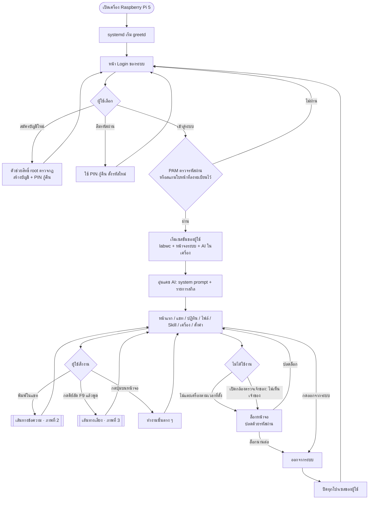
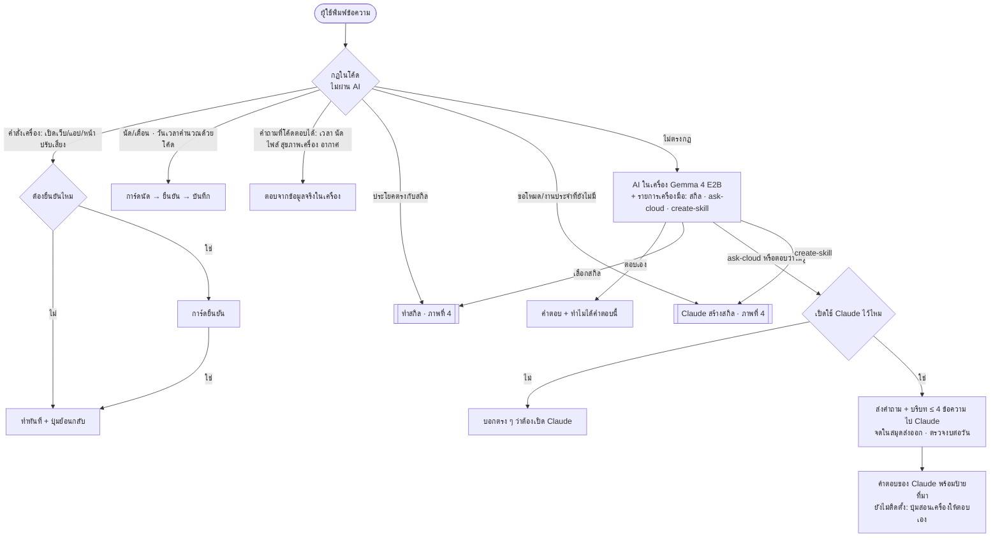
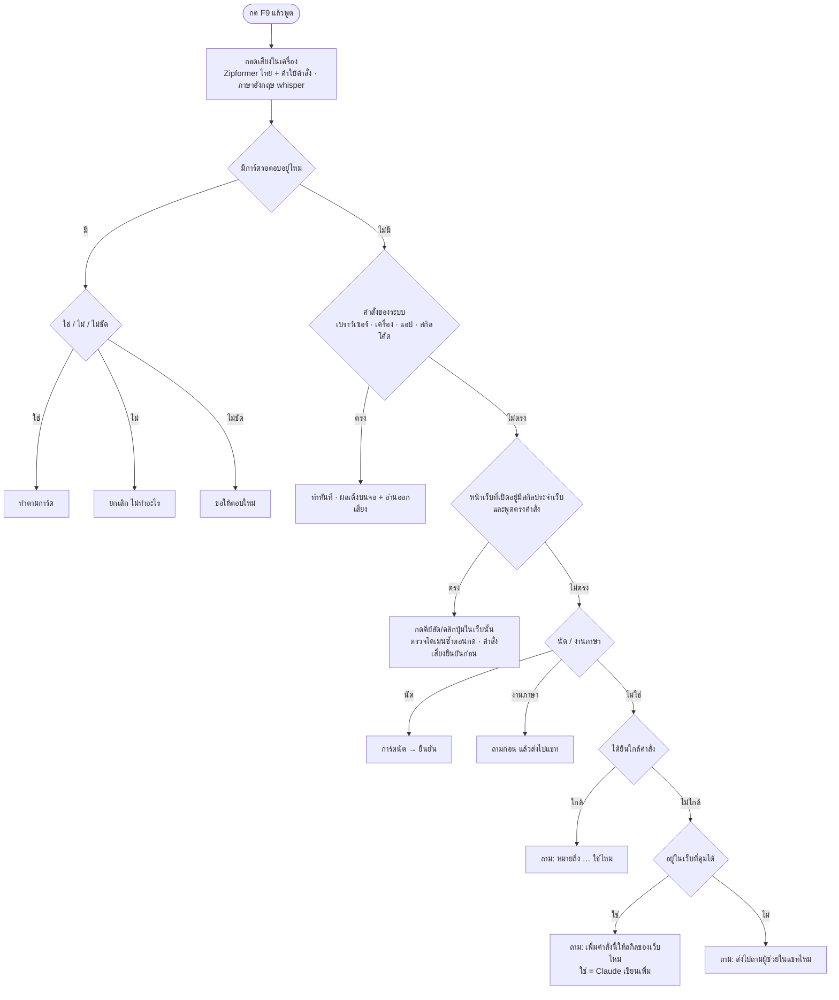
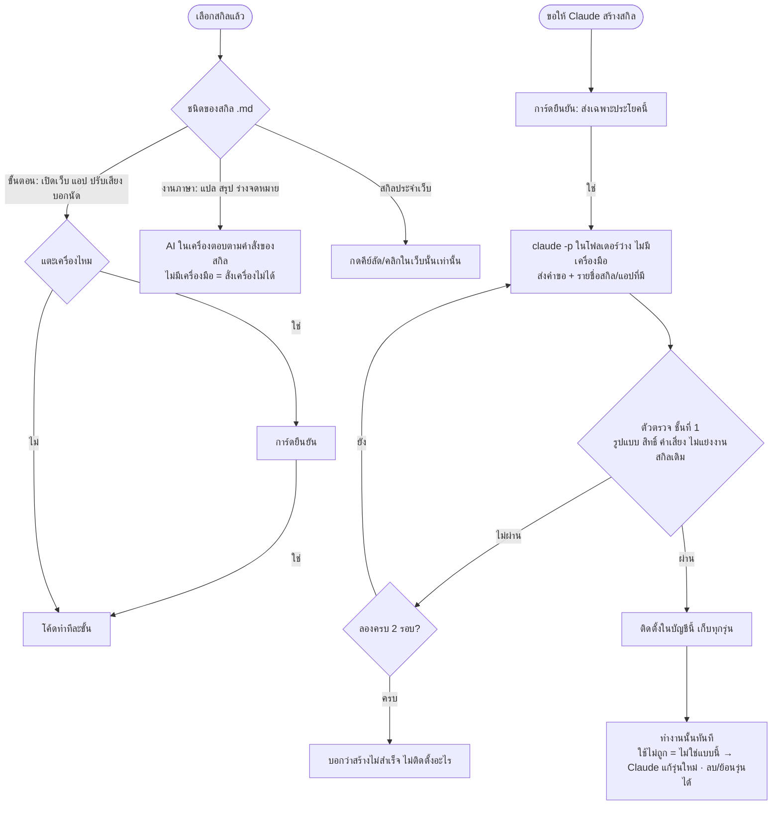

# Flowchart ของระบบ AI Personal Computer V2

> ตามโค้ดที่มีจริง (ARCHITECTURE.md · การ์ด 0003/0004 0012 0013 0016–0018 0020 0024 0027–0030 0042 0045 0046) · รุ่นที่ติดตั้ง `efc14546` ·
> ส่วนที่อยู่บนสาขาแต่ยังไม่ติดตั้ง (0047 ปุ่มสอนเครื่อง · 0049 · 0050) ระบุไว้ในวงเล็บ · Mermaid → แปลงเป็นรูปก่อนใส่เล่ม (เช่น mermaid.live)

## ภาพที่ 1 ภาพรวม: เปิดเครื่อง → เข้าสู่ระบบ → ใช้งาน → ออก

## ภาพที่ 2 เส้นทางของข้อความที่พิมพ์

## ภาพที่ 3 เส้นทางเสียง (คีย์ลัด F9)

## ภาพที่ 4 สกิล: ทำงาน และให้ Claude สร้าง

